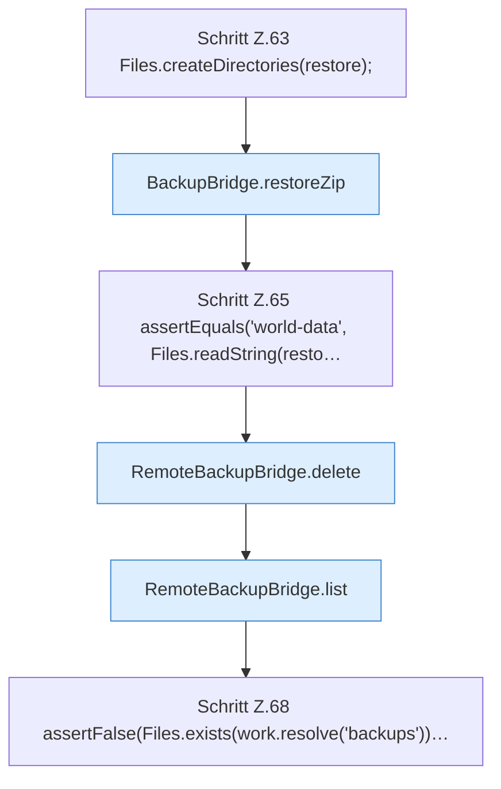

[[00 Start]] › [[Tests]] › [[RemoteBackupBridgeTest]] › [[RemoteBackupBridgeTest.autoModeStreamsFtpBackupAndFinalizesPartialUpload]] › [[RemoteBackupBridgeTest.autoModeStreamsFtpBackupAndFinalizesPartialUpload.Z37.Teil3]]

# RemoteBackupBridgeTest.autoModeStreamsFtpBackupAndFinalizesPartialUpload.Z37.Teil3

- Fortsetzung von `RemoteBackupBridgeTest.autoModeStreamsFtpBackupAndFinalizesPartialUpload.Z37`, Quellreihenfolge.
