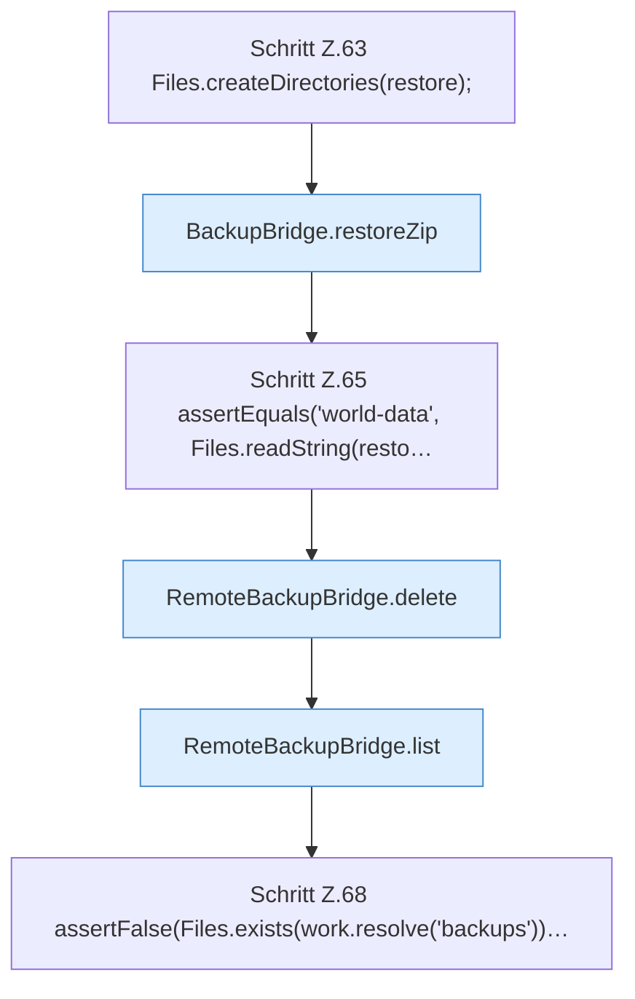

[[00 Start]] › [[Tests]] › [[RemoteBackupBridgeTest]] › [[RemoteBackupBridgeTest.autoModeStreamsFtpBackupAndFinalizesPartialUpload]] › [[RemoteBackupBridgeTest.autoModeStreamsFtpBackupAndFinalizesPartialUpload.Z37.Teil3]]

# RemoteBackupBridgeTest.autoModeStreamsFtpBackupAndFinalizesPartialUpload.Z37.Teil3



```knoten
Schritt Z.63 Files.createDirectories(restore);
  Zeile 63: Dateioperation. `Files.createDirectories(restore);`
BackupBridge.restoreZip
  Stellt wieder her `restoreZip`. Ruft `open`, `resolve`.
Schritt Z.65 assertEquals('world-data', Files.readString(resto…
  Zeile 65: liest Text aus einer Datei. `assertEquals('world-data', Files.readString(resto…`
RemoteBackupBridge.delete
  Löscht `delete`. Ruft `safeId`, `named`, `connect`.
RemoteBackupBridge.list
  Listet `list`. Ruft `safeId`, `connect`, `enterDirectory`.
Schritt Z.68 assertFalse(Files.exists(work.resolve('backups'))…
  Zeile 68: Dateioperation. `assertFalse(Files.exists(work.resolve('backups'))…`
```

- Fortsetzung von `RemoteBackupBridgeTest.autoModeStreamsFtpBackupAndFinalizesPartialUpload.Z37`, Quellreihenfolge.
