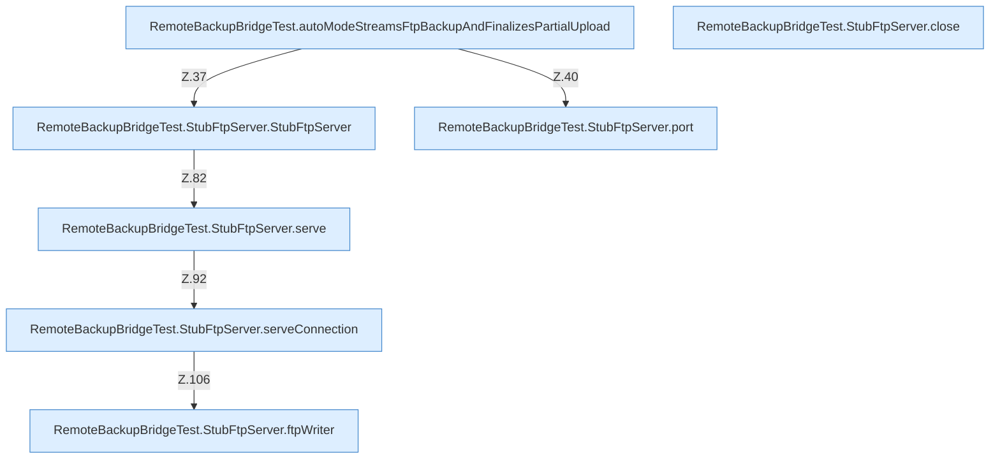

[[00 Start]] › [[Tests]] › [[RemoteBackupBridgeTest]]

# RemoteBackupBridgeTest



```knoten
RemoteBackupBridgeTest.autoModeStreamsFtpBackupAndFinalizesPartialUpload
  `autoModeStreamsFtpBackupAndFinalizesPartialUpload` in `RemoteBackupBridgeTest.java`. Ruft `StubFtpServer`, `port`, `archive`. Nur Test.
RemoteBackupBridgeTest.StubFtpServer.StubFtpServer
  `StubFtpServer` in `RemoteBackupBridgeTest.java`. Ruft `serve`. Nur Test.
RemoteBackupBridgeTest.StubFtpServer.port
  Prüft oder liefert den Port `port`. Nur Test.
RemoteBackupBridgeTest.StubFtpServer.serve
  Liefert `serve`. Ruft `serveConnection`. Nur Test.
RemoteBackupBridgeTest.StubFtpServer.serveConnection
  Liefert `serveConnection`. Ruft `ftpWriter`. Nur Test.
RemoteBackupBridgeTest.StubFtpServer.ftpWriter
  `ftpWriter` in `RemoteBackupBridgeTest.java`. Ruft `println`. Nur Test.
RemoteBackupBridgeTest.StubFtpServer.close
  Schließt `close`. Nur Test.
```


