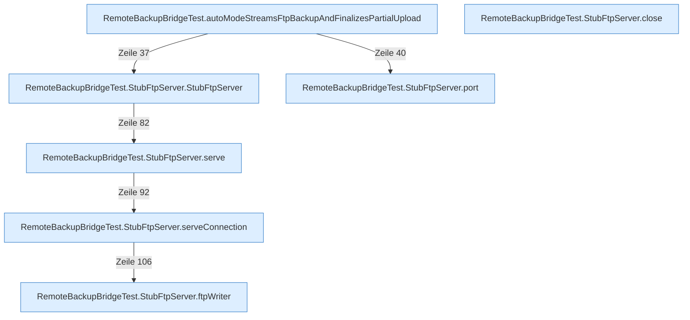

[[00 Start]] › [[Tests]] › [[RemoteBackupBridgeTest]]

# RemoteBackupBridgeTest



```knoten
RemoteBackupBridgeTest.autoModeStreamsFtpBackupAndFinalizesPartialUpload
  Ein Schritt in einem [[Glossar#Probelauf|Probelauf]]. Er gehört nicht zum laufenden Server.
RemoteBackupBridgeTest.StubFtpServer.StubFtpServer
  Ein Schritt in einem [[Glossar#Probelauf|Probelauf]]. Er gehört nicht zum laufenden Server.
RemoteBackupBridgeTest.StubFtpServer.port
  Ein Schritt in einem [[Glossar#Probelauf|Probelauf]]. Er gehört nicht zum laufenden Server.
RemoteBackupBridgeTest.StubFtpServer.serve
  Ein Schritt in einem [[Glossar#Probelauf|Probelauf]]. Er gehört nicht zum laufenden Server.
RemoteBackupBridgeTest.StubFtpServer.serveConnection
  Ein Schritt in einem [[Glossar#Probelauf|Probelauf]]. Er gehört nicht zum laufenden Server.
RemoteBackupBridgeTest.StubFtpServer.ftpWriter
  Ein Schritt in einem [[Glossar#Probelauf|Probelauf]]. Er gehört nicht zum laufenden Server.
RemoteBackupBridgeTest.StubFtpServer.close
  Ein Schritt in einem [[Glossar#Probelauf|Probelauf]]. Er gehört nicht zum laufenden Server.
```

> [!knoten] Was die Blöcke tun
> - **RemoteBackupBridgeTest.autoModeStreamsFtpBackupAndFinalizesPartialUpload**: Ein Schritt in einem [[Glossar#Probelauf|Probelauf]]. Er gehört nicht zum laufenden Server.
> - **RemoteBackupBridgeTest.StubFtpServer.StubFtpServer**: Ein Schritt in einem [[Glossar#Probelauf|Probelauf]]. Er gehört nicht zum laufenden Server.
> - **RemoteBackupBridgeTest.StubFtpServer.port**: Ein Schritt in einem [[Glossar#Probelauf|Probelauf]]. Er gehört nicht zum laufenden Server.
> - **RemoteBackupBridgeTest.StubFtpServer.serve**: Ein Schritt in einem [[Glossar#Probelauf|Probelauf]]. Er gehört nicht zum laufenden Server.
> - **RemoteBackupBridgeTest.StubFtpServer.serveConnection**: Ein Schritt in einem [[Glossar#Probelauf|Probelauf]]. Er gehört nicht zum laufenden Server.
> - **RemoteBackupBridgeTest.StubFtpServer.ftpWriter**: Ein Schritt in einem [[Glossar#Probelauf|Probelauf]]. Er gehört nicht zum laufenden Server.
> - **RemoteBackupBridgeTest.StubFtpServer.close**: Ein Schritt in einem [[Glossar#Probelauf|Probelauf]]. Er gehört nicht zum laufenden Server.

- [[Glossar#Probelauf|Probelauf]] für die [[Glossar#Sicherungskopie|Sicherungskopie]] über das Netz.
