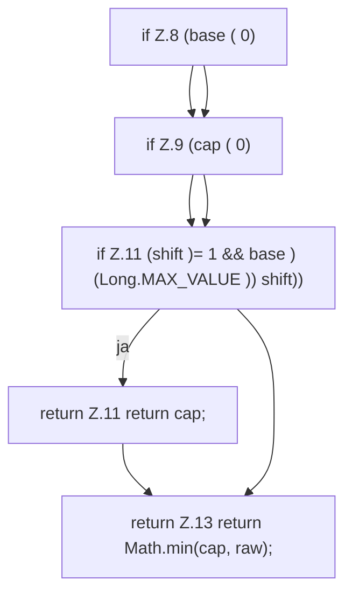

[[00 Start]] › [[Child-Prozess]] › [[Prozess-Bausteine]] › [[RestartBackoff]] › [[RestartBackoff.delaySeconds]]

# RestartBackoff.delaySeconds

`RestartBackoff.delaySeconds(long base, long cap, int attempts)` [src/main/java/de/aichele/childlauncher/RestartBackoff.java:7–14](https://github.com/Sciddie/minecraft-serverhoster-plugin/blob/95b02b953b0b4c23673e900e021a7c3c844aa37d/src/main/java/de/aichele/childlauncher/RestartBackoff.java#L7-L14)



```knoten
if Z.8 (base ( 0)
  Zeile 8: prüft `(base ( 0)`.
if Z.9 (cap ( 0)
  Zeile 9: prüft `(cap ( 0)`.
if Z.11 (shift )= 1 && base ) (Long.MAX_VALUE )) shift))
  Zeile 11: prüft `(shift )= 1 && base ) (Long.MAX_VALUE )) shift))`.
return Z.11 return cap;
  Zeile 11: Rückgabe `return cap;`.
return Z.13 return Math.min(cap, raw);
  Zeile 13: Rückgabe `return Math.min(cap, raw);`.
```

> [!knoten]- Was die Blöcke tun
> - **if Z.8 (base ( 0)**: Zeile 8: prüft `(base ( 0)`.
> - **if Z.9 (cap ( 0)**: Zeile 9: prüft `(cap ( 0)`.
> - **if Z.11 (shift )= 1 && base ) (Long.MAX_VALUE )) shift))**: Zeile 11: prüft `(shift )= 1 && base ) (Long.MAX_VALUE )) shift))`.
> - **return Z.11 return cap;**: Zeile 11: Rückgabe `return cap;`.
> - **return Z.13 return Math.min(cap, raw);**: Zeile 13: Rückgabe `return Math.min(cap, raw);`.

- Dieser Teil macht hier einen einzelnen Schritt. Eine Ebene tiefer steht er genauer.
- `delaySeconds` in `src/main/java/de/aichele/childlauncher/RestartBackoff.java`
