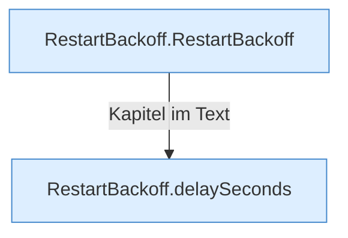

[[00 Start]] › [[Child-Prozess]] › [[Prozess-Bausteine]] › [[RestartBackoff]]

# RestartBackoff



```knoten
RestartBackoff.RestartBackoff
  Dieser Teil kümmert sich um die [[Glossar#Pause|Pause]]. Im [[Glossar#Quelltext|Quelltext]] heißt das `RestartBackoff`.
RestartBackoff.delaySeconds
  Dieser Teil macht hier einen einzelnen Schritt. Eine Ebene tiefer steht er genauer. Im [[Glossar#Quelltext|Quelltext]] heißt das `delaySeconds`.
```

> [!knoten]- Was die Blöcke tun
> - **RestartBackoff.RestartBackoff**: Dieser Teil kümmert sich um die [[Glossar#Pause|Pause]]. Im [[Glossar#Quelltext|Quelltext]] heißt das `RestartBackoff`.
> - **RestartBackoff.delaySeconds**: Dieser Teil macht hier einen einzelnen Schritt. Eine Ebene tiefer steht er genauer. Im [[Glossar#Quelltext|Quelltext]] heißt das `delaySeconds`.

- Rechnet die [[Glossar#Pause|Pause]] vor dem nächsten [[Glossar#Neustart|Neustart]] aus.
