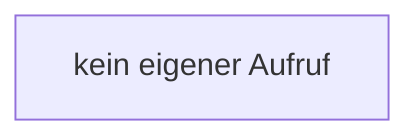

[[00 Start]] › [[Child-Prozess]] › [[Prozess-Bausteine]] › [[RestartPolicy]] › [[RestartPolicy.RestartPolicy]]

# RestartPolicy.RestartPolicy

`RestartPolicy.RestartPolicy()` [src/main/java/de/aichele/childlauncher/RestartPolicy.java:9–9](https://github.com/Sciddie/minecraft-serverhoster-plugin/blob/95b02b953b0b4c23673e900e021a7c3c844aa37d/src/main/java/de/aichele/childlauncher/RestartPolicy.java#L9-L9)



```knoten
kein eigener Aufruf
  In diesem Stück gibt es keinen weiteren eigenen Aufruf.
```

- `RestartPolicy` in `src/main/java/de/aichele/childlauncher/RestartPolicy.java`
