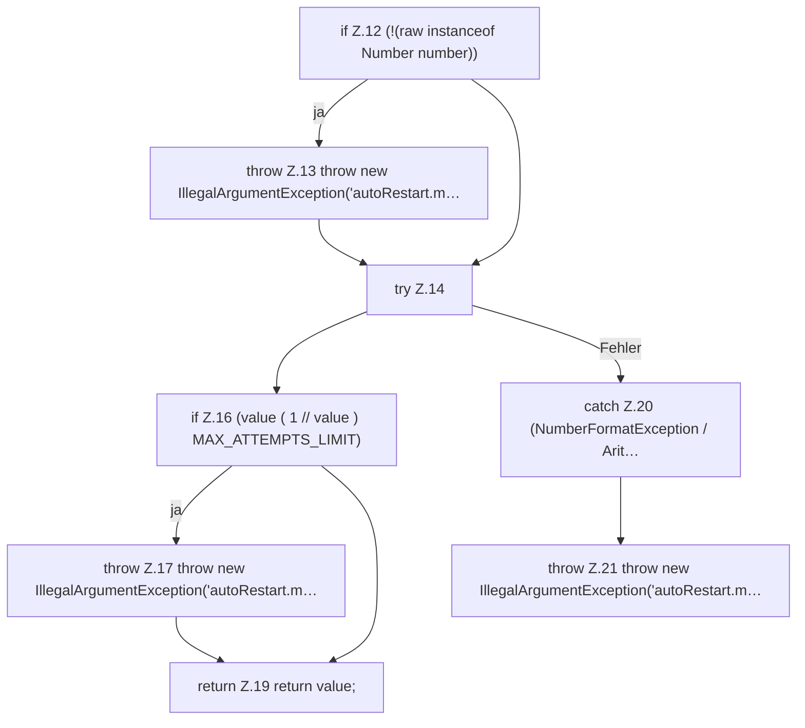

[[00 Start]] › [[Child-Prozess]] › [[Prozess-Bausteine]] › [[RestartPolicy]] › [[RestartPolicy.maxAttempts]]

# RestartPolicy.maxAttempts

`RestartPolicy.maxAttempts(Object raw)` [src/main/java/de/aichele/childlauncher/RestartPolicy.java:11–23](https://github.com/Sciddie/minecraft-serverhoster-plugin/blob/95b02b953b0b4c23673e900e021a7c3c844aa37d/src/main/java/de/aichele/childlauncher/RestartPolicy.java#L11-L23)

- `maxAttempts` in `src/main/java/de/aichele/childlauncher/RestartPolicy.java`
