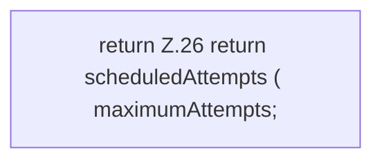

[[00 Start]] › [[Child-Prozess]] › [[Prozess-Bausteine]] › [[RestartPolicy]] › [[RestartPolicy.mayRetry]]

# RestartPolicy.mayRetry

`RestartPolicy.mayRetry(int scheduledAttempts, int maximumAttempts)` [src/main/java/de/aichele/childlauncher/RestartPolicy.java:25–27](https://github.com/Sciddie/minecraft-serverhoster-plugin/blob/95b02b953b0b4c23673e900e021a7c3c844aa37d/src/main/java/de/aichele/childlauncher/RestartPolicy.java#L25-L27)



```knoten
return Z.26 return scheduledAttempts ( maximumAttempts;
  Zeile 26: Rückgabe `return scheduledAttempts ( maximumAttempts;`.
```

> [!knoten]- Was die Blöcke tun
> - **return Z.26 return scheduledAttempts ( maximumAttempts;**: Zeile 26: Rückgabe `return scheduledAttempts ( maximumAttempts;`.

- Dieser Teil macht hier einen einzelnen Schritt. Eine Ebene tiefer steht er genauer.
- `mayRetry` in `src/main/java/de/aichele/childlauncher/RestartPolicy.java`
