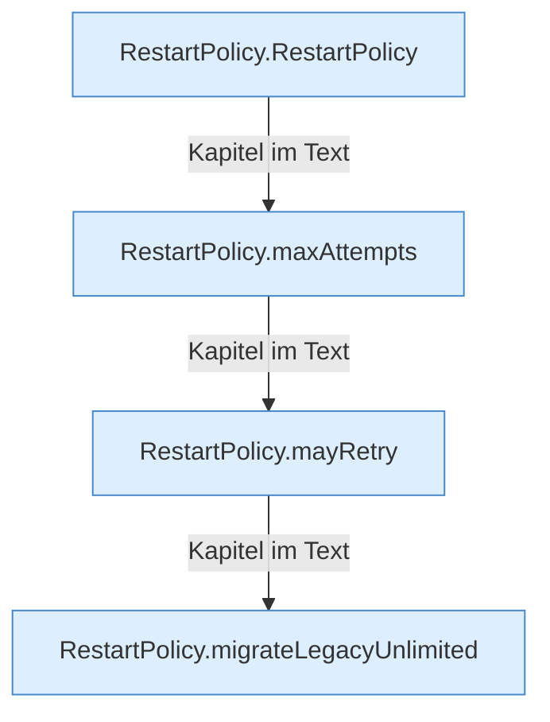

[[00 Start]] › [[Child-Prozess]] › [[Prozess-Bausteine]] › [[RestartPolicy]]

# RestartPolicy



```knoten
RestartPolicy.RestartPolicy
  Dieser Teil kümmert sich um die Regel. Im [[Glossar#Quelltext|Quelltext]] heißt das `RestartPolicy`.
RestartPolicy.maxAttempts
  Dieser Teil macht hier einen einzelnen Schritt. Eine Ebene tiefer steht er genauer. Im [[Glossar#Quelltext|Quelltext]] heißt das `maxAttempts`.
RestartPolicy.mayRetry
  Dieser Teil macht hier einen einzelnen Schritt. Eine Ebene tiefer steht er genauer. Im [[Glossar#Quelltext|Quelltext]] heißt das `mayRetry`.
RestartPolicy.migrateLegacyUnlimited
  Dieser Teil übernimmt den alten Wert von den alten Weg. Im [[Glossar#Quelltext|Quelltext]] heißt das `migrateLegacyUnlimited`.
```

> [!knoten]- Was die Blöcke tun
> - **RestartPolicy.RestartPolicy**: Dieser Teil kümmert sich um die Regel. Im [[Glossar#Quelltext|Quelltext]] heißt das `RestartPolicy`.
> - **RestartPolicy.maxAttempts**: Dieser Teil macht hier einen einzelnen Schritt. Eine Ebene tiefer steht er genauer. Im [[Glossar#Quelltext|Quelltext]] heißt das `maxAttempts`.
> - **RestartPolicy.mayRetry**: Dieser Teil macht hier einen einzelnen Schritt. Eine Ebene tiefer steht er genauer. Im [[Glossar#Quelltext|Quelltext]] heißt das `mayRetry`.
> - **RestartPolicy.migrateLegacyUnlimited**: Dieser Teil übernimmt den alten Wert von den alten Weg. Im [[Glossar#Quelltext|Quelltext]] heißt das `migrateLegacyUnlimited`.

- Die Regel, ob und wie oft der [[Glossar#Spielserver|Spielserver]] von allein neu starten darf.
