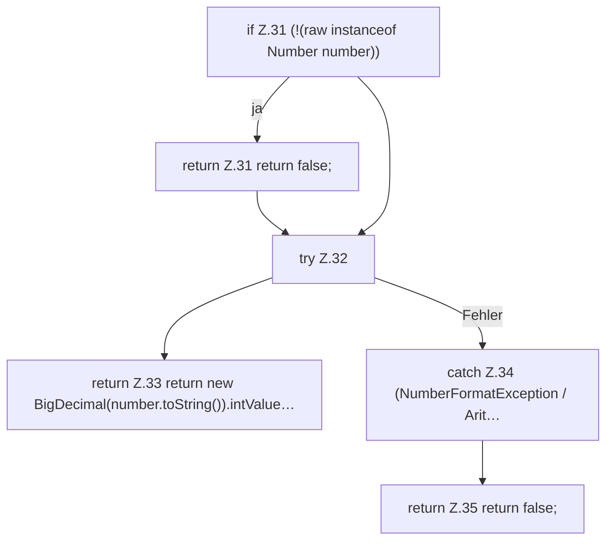

[[00 Start]] › [[Child-Prozess]] › [[Prozess-Bausteine]] › [[RestartPolicy]] › [[RestartPolicy.migrateLegacyUnlimited]]

# RestartPolicy.migrateLegacyUnlimited

`RestartPolicy.migrateLegacyUnlimited(Object raw)` [src/main/java/de/aichele/childlauncher/RestartPolicy.java:30–37](https://github.com/Sciddie/minecraft-serverhoster-plugin/blob/95b02b953b0b4c23673e900e021a7c3c844aa37d/src/main/java/de/aichele/childlauncher/RestartPolicy.java#L30-L37)



```knoten
if Z.31 (!(raw instanceof Number number))
  Zeile 31: prüft `(!(raw instanceof Number number))`.
return Z.31 return false;
  Zeile 31: Rückgabe `return false;`.
try Z.32
  Zeile 32: Versuch. Der Fehlerpfad geht in catch.
return Z.33 return new BigDecimal(number.toString()).intValue…
  Zeile 33: Rückgabe `return new BigDecimal(number.toString()).intValue…`.
catch Z.34 (NumberFormatException / Arit…
  Zeile 34: fängt (NumberFormatException / Arit….
return Z.35 return false;
  Zeile 35: Rückgabe `return false;`.
```

- `migrateLegacyUnlimited` in `src/main/java/de/aichele/childlauncher/RestartPolicy.java`
