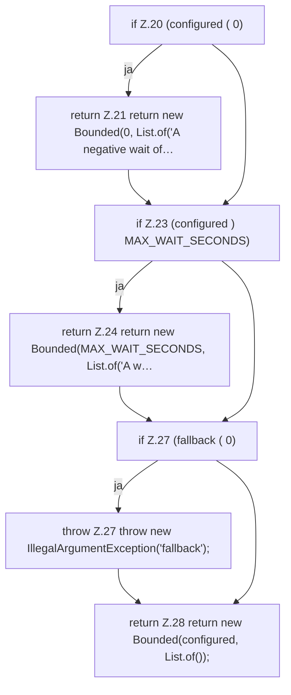

[[00 Start]] › [[Host-Betrieb]] › [[Speicher-Messung]] › [[RuntimeLimits]] › [[RuntimeLimits.boundedSeconds]]

# RuntimeLimits.boundedSeconds

`RuntimeLimits.boundedSeconds(long configured, long fallback)` [src/main/java/de/aichele/childlauncher/RuntimeLimits.java:19–29](https://github.com/Sciddie/minecraft-serverhoster-plugin/blob/95b02b953b0b4c23673e900e021a7c3c844aa37d/src/main/java/de/aichele/childlauncher/RuntimeLimits.java#L19-L29)



```knoten
if Z.20 (configured ( 0)
  Zeile 20: prüft `(configured ( 0)`.
return Z.21 return new Bounded(0, List.of('A negative wait of…
  Zeile 21: Rückgabe `return new Bounded(0, List.of('A negative wait of…`.
if Z.23 (configured ) MAX_WAIT_SECONDS)
  Zeile 23: prüft `(configured ) MAX_WAIT_SECONDS)`.
return Z.24 return new Bounded(MAX_WAIT_SECONDS, List.of('A w…
  Zeile 24: Rückgabe `return new Bounded(MAX_WAIT_SECONDS, List.of('A w…`.
if Z.27 (fallback ( 0)
  Zeile 27: prüft `(fallback ( 0)`.
throw Z.27 throw new IllegalArgumentException('fallback');
  Zeile 27: Abbruch `throw new IllegalArgumentException('fallback');`.
return Z.28 return new Bounded(configured, List.of());
  Zeile 28: Rückgabe `return new Bounded(configured, List.of());`.
```

- `boundedSeconds` in `src/main/java/de/aichele/childlauncher/RuntimeLimits.java`
