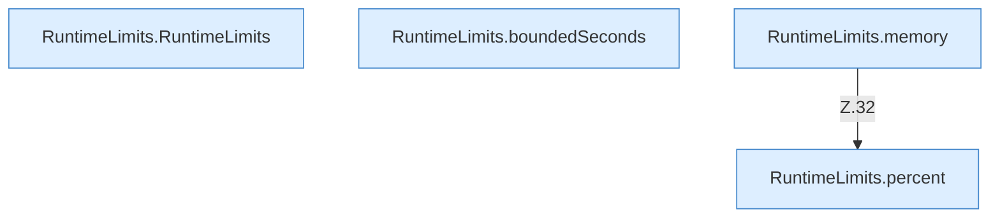

[[00 Start]] › [[Host-Betrieb]] › [[Speicher-Messung]] › [[RuntimeLimits]]

# RuntimeLimits



```knoten
RuntimeLimits.RuntimeLimits
  Dieser Teil kümmert sich um die Grenzen. Im [[Glossar#Quelltext|Quelltext]] heißt das `RuntimeLimits`.
RuntimeLimits.boundedSeconds
  Dieser Teil macht hier einen einzelnen Schritt. Eine Ebene tiefer steht er genauer. Im [[Glossar#Quelltext|Quelltext]] heißt das `boundedSeconds`.
RuntimeLimits.memory
  Dieser Teil macht hier einen einzelnen Schritt. Eine Ebene tiefer steht er genauer. Im [[Glossar#Quelltext|Quelltext]] heißt das `memory`.
RuntimeLimits.percent
  Dieser Teil macht hier einen einzelnen Schritt. Eine Ebene tiefer steht er genauer. Im [[Glossar#Quelltext|Quelltext]] heißt das `percent`.
```

> [!knoten]- Was die Blöcke tun
> - **RuntimeLimits.RuntimeLimits**: Dieser Teil kümmert sich um die Grenzen. Im [[Glossar#Quelltext|Quelltext]] heißt das `RuntimeLimits`.
> - **RuntimeLimits.boundedSeconds**: Dieser Teil macht hier einen einzelnen Schritt. Eine Ebene tiefer steht er genauer. Im [[Glossar#Quelltext|Quelltext]] heißt das `boundedSeconds`.
> - **RuntimeLimits.memory**: Dieser Teil macht hier einen einzelnen Schritt. Eine Ebene tiefer steht er genauer. Im [[Glossar#Quelltext|Quelltext]] heißt das `memory`.
> - **RuntimeLimits.percent**: Dieser Teil macht hier einen einzelnen Schritt. Eine Ebene tiefer steht er genauer. Im [[Glossar#Quelltext|Quelltext]] heißt das `percent`.

- Hält Zahlen in einem erlaubten Bereich, damit eine Einstellung nicht unsinnig groß oder klein wird. Die Frist beim Ausschalten des [[Glossar#Host|Host]] ist so begrenzt, Ersatzwert 25 Sekunden.
