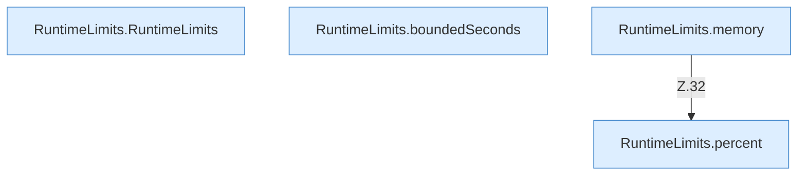

[[00 Start]] › [[Host-Betrieb]] › [[Speicher-Messung]] › [[RuntimeLimits]]

# RuntimeLimits



```knoten
RuntimeLimits.RuntimeLimits
  `RuntimeLimits` in `RuntimeLimits.java`.
RuntimeLimits.boundedSeconds
  Begrenzt `boundedSeconds`.
RuntimeLimits.memory
  Betrifft den Speicher `memory`. Ruft `percent`.
RuntimeLimits.percent
  `percent` in `RuntimeLimits.java`.
```


