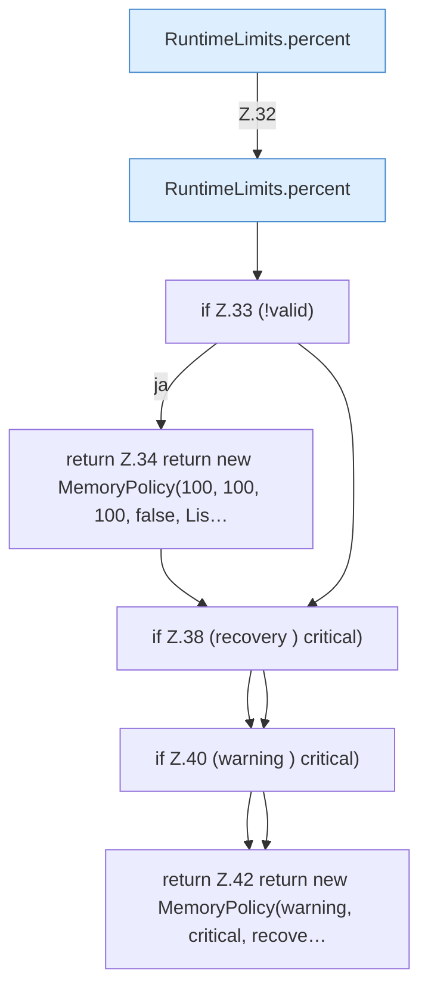

[[00 Start]] › [[Host-Betrieb]] › [[Speicher-Messung]] › [[RuntimeLimits]] › [[RuntimeLimits.memory]]

# RuntimeLimits.memory

`RuntimeLimits.memory(double warning, double critical, double recovery, boolean requestedAutoStop)` [src/main/java/de/aichele/childlauncher/RuntimeLimits.java:31–43](https://github.com/Sciddie/minecraft-serverhoster-plugin/blob/95b02b953b0b4c23673e900e021a7c3c844aa37d/src/main/java/de/aichele/childlauncher/RuntimeLimits.java#L31-L43)

- `memory` in `src/main/java/de/aichele/childlauncher/RuntimeLimits.java`
