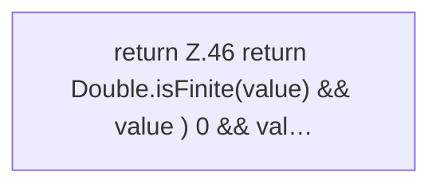

[[00 Start]] › [[Host-Betrieb]] › [[Speicher-Messung]] › [[RuntimeLimits]] › [[RuntimeLimits.percent]]

# RuntimeLimits.percent

`RuntimeLimits.percent(double value)` [src/main/java/de/aichele/childlauncher/RuntimeLimits.java:45–47](https://github.com/Sciddie/minecraft-serverhoster-plugin/blob/95b02b953b0b4c23673e900e021a7c3c844aa37d/src/main/java/de/aichele/childlauncher/RuntimeLimits.java#L45-L47)

- `percent` in `src/main/java/de/aichele/childlauncher/RuntimeLimits.java`
