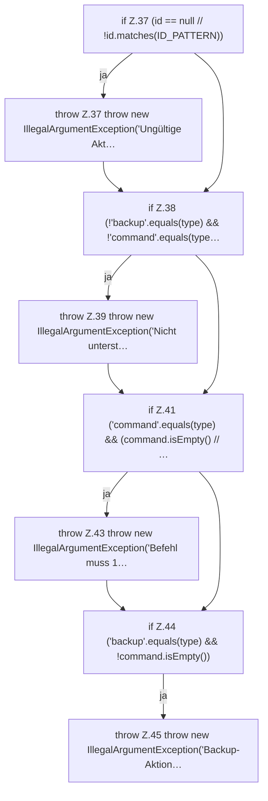

[[00 Start]] › [[Zeitplaene]] › [[Plan-Klassen]] › [[ScheduleDef]] › [[Action]] › [[ScheduleDef.Action.Action]]

# ScheduleDef.Action.Action

`ScheduleDef.Action.Action()` [src/main/java/de/aichele/childlauncher/ScheduleDef.java:36–46](https://github.com/Sciddie/minecraft-serverhoster-plugin/blob/95b02b953b0b4c23673e900e021a7c3c844aa37d/src/main/java/de/aichele/childlauncher/ScheduleDef.java#L36-L46)



```knoten
if Z.37 (id == null // !id.matches(ID_PATTERN))
  Zeile 37: prüft `(id == null // !id.matches(ID_PATTERN))`.
throw Z.37 throw new IllegalArgumentException('Ungültige Akt…
  Zeile 37: Abbruch `throw new IllegalArgumentException('Ungültige Akt…`.
if Z.38 (!'backup'.equals(type) && !'command'.equals(type…
  Zeile 38: prüft `(!'backup'.equals(type) && !'command'.equals(type…`.
throw Z.39 throw new IllegalArgumentException('Nicht unterst…
  Zeile 39: Abbruch `throw new IllegalArgumentException('Nicht unterst…`.
if Z.41 ('command'.equals(type) && (command.isEmpty() // …
  Zeile 41: prüft `('command'.equals(type) && (command.isEmpty() // …`.
throw Z.43 throw new IllegalArgumentException('Befehl muss 1…
  Zeile 43: Abbruch `throw new IllegalArgumentException('Befehl muss 1…`.
if Z.44 ('backup'.equals(type) && !command.isEmpty())
  Zeile 44: prüft `('backup'.equals(type) && !command.isEmpty())`.
throw Z.45 throw new IllegalArgumentException('Backup-Aktion…
  Zeile 45: Abbruch `throw new IllegalArgumentException('Backup-Aktion…`.
```

- `Action` in `src/main/java/de/aichele/childlauncher/ScheduleDef.java`
