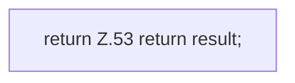

[[00 Start]] › [[Zeitplaene]] › [[Plan-Klassen]] › [[ScheduleDef]] › [[Action]] › [[ScheduleDef.Action.toConfig]]

# ScheduleDef.Action.toConfig

`ScheduleDef.Action.toConfig()` [src/main/java/de/aichele/childlauncher/ScheduleDef.java:48–54](https://github.com/Sciddie/minecraft-serverhoster-plugin/blob/95b02b953b0b4c23673e900e021a7c3c844aa37d/src/main/java/de/aichele/childlauncher/ScheduleDef.java#L48-L54)



```knoten
return Z.53 return result;
  Zeile 53: Rückgabe `return result;`.
```

> [!knoten]- Was die Blöcke tun
> - **return Z.53 return result;**: Zeile 53: Rückgabe `return result;`.

- Der [[Glossar#Zeitplan|Zeitplan]] kümmert sich um die [[Glossar#Einstellungen|Einstellungen]].
- `toConfig` in `src/main/java/de/aichele/childlauncher/ScheduleDef.java`
