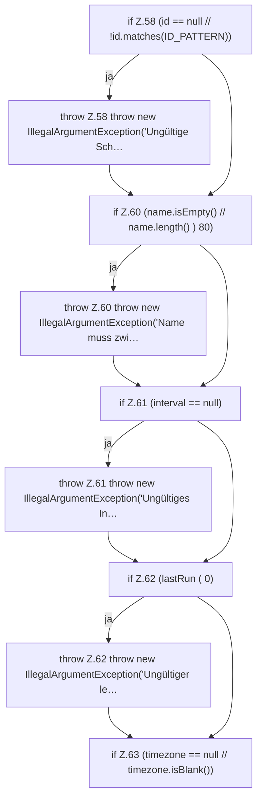

[[00 Start]] › [[Zeitplaene]] › [[Plan-Klassen]] › [[ScheduleDef]] › [[ScheduleDef.Teil1]] › [[ScheduleDef.ScheduleDef]] › [[ScheduleDef.ScheduleDef.Teil1]]

# ScheduleDef.ScheduleDef.Teil1



```knoten
if Z.58 (id == null // !id.matches(ID_PATTERN))
  Zeile 58: prüft `(id == null // !id.matches(ID_PATTERN))`.
throw Z.58 throw new IllegalArgumentException('Ungültige Sch…
  Zeile 58: Abbruch `throw new IllegalArgumentException('Ungültige Sch…`.
if Z.60 (name.isEmpty() // name.length() ) 80)
  Zeile 60: prüft `(name.isEmpty() // name.length() ) 80)`.
throw Z.60 throw new IllegalArgumentException('Name muss zwi…
  Zeile 60: Abbruch `throw new IllegalArgumentException('Name muss zwi…`.
if Z.61 (interval == null)
  Zeile 61: prüft `(interval == null)`.
throw Z.61 throw new IllegalArgumentException('Ungültiges In…
  Zeile 61: Abbruch `throw new IllegalArgumentException('Ungültiges In…`.
if Z.62 (lastRun ( 0)
  Zeile 62: prüft `(lastRun ( 0)`.
throw Z.62 throw new IllegalArgumentException('Ungültiger le…
  Zeile 62: Abbruch `throw new IllegalArgumentException('Ungültiger le…`.
if Z.63 (timezone == null // timezone.isBlank())
  Zeile 63: prüft `(timezone == null // timezone.isBlank())`.
```

> [!knoten]- Was die Blöcke tun
> - **if Z.58 (id == null // !id.matches(ID_PATTERN))**: Zeile 58: prüft `(id == null // !id.matches(ID_PATTERN))`.
> - **throw Z.58 throw new IllegalArgumentException('Ungültige Sch…**: Zeile 58: Abbruch `throw new IllegalArgumentException('Ungültige Sch…`.
> - **if Z.60 (name.isEmpty() // name.length() ) 80)**: Zeile 60: prüft `(name.isEmpty() // name.length() ) 80)`.
> - **throw Z.60 throw new IllegalArgumentException('Name muss zwi…**: Zeile 60: Abbruch `throw new IllegalArgumentException('Name muss zwi…`.
> - **if Z.61 (interval == null)**: Zeile 61: prüft `(interval == null)`.
> - **throw Z.61 throw new IllegalArgumentException('Ungültiges In…**: Zeile 61: Abbruch `throw new IllegalArgumentException('Ungültiges In…`.
> - **if Z.62 (lastRun ( 0)**: Zeile 62: prüft `(lastRun ( 0)`.
> - **throw Z.62 throw new IllegalArgumentException('Ungültiger le…**: Zeile 62: Abbruch `throw new IllegalArgumentException('Ungültiger le…`.
> - **if Z.63 (timezone == null // timezone.isBlank())**: Zeile 63: prüft `(timezone == null // timezone.isBlank())`.

- Ein weiterer Abschnitt derselben Übersicht.
- Fortsetzung von `ScheduleDef.ScheduleDef`.
