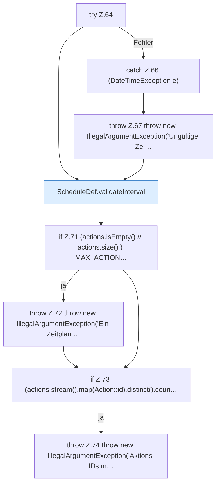

[[00 Start]] › [[Zeitplaene]] › [[Plan-Klassen]] › [[ScheduleDef]] › [[ScheduleDef.Teil1]] › [[ScheduleDef.ScheduleDef]] › [[ScheduleDef.ScheduleDef.Teil2]]

# ScheduleDef.ScheduleDef.Teil2

- Fortsetzung von `ScheduleDef.ScheduleDef`, Quellreihenfolge.
