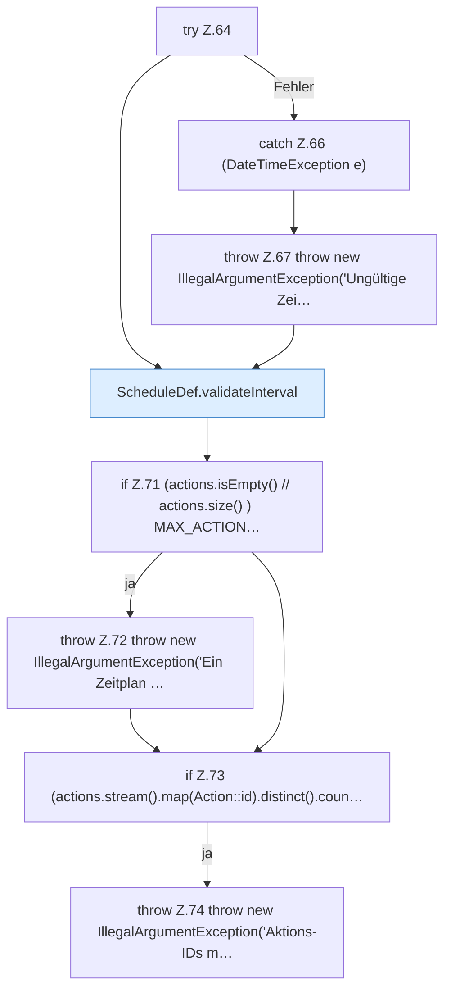

[[00 Start]] › [[Zeitplaene]] › [[Plan-Klassen]] › [[ScheduleDef]] › [[ScheduleDef.Teil1]] › [[ScheduleDef.ScheduleDef]] › [[ScheduleDef.ScheduleDef.Teil2]]

# ScheduleDef.ScheduleDef.Teil2



```knoten
try Z.64
  Zeile 64: Versuch. Der Fehlerpfad geht in catch.
catch Z.66 (DateTimeException e)
  Zeile 66: fängt (DateTimeException e).
throw Z.67 throw new IllegalArgumentException('Ungültige Zei…
  Zeile 67: Abbruch `throw new IllegalArgumentException('Ungültige Zei…`.
ScheduleDef.validateInterval
  Der [[Glossar#Zeitplan|Zeitplan]] prüft hier einen Schritt. Eine Ebene tiefer steht er genauer. Prüft `validateInterval`.
if Z.71 (actions.isEmpty() // actions.size() ) MAX_ACTION…
  Zeile 71: prüft `(actions.isEmpty() // actions.size() ) MAX_ACTION…`.
throw Z.72 throw new IllegalArgumentException('Ein Zeitplan …
  Zeile 72: Abbruch `throw new IllegalArgumentException('Ein Zeitplan …`.
if Z.73 (actions.stream().map(Action::id).distinct().coun…
  Zeile 73: prüft `(actions.stream().map(Action::id).distinct().coun…`.
throw Z.74 throw new IllegalArgumentException('Aktions-IDs m…
  Zeile 74: Abbruch `throw new IllegalArgumentException('Aktions-IDs m…`.
```

> [!knoten]- Was die Blöcke tun
> - **try Z.64**: Zeile 64: Versuch. Der Fehlerpfad geht in catch.
> - **catch Z.66 (DateTimeException e)**: Zeile 66: fängt (DateTimeException e).
> - **throw Z.67 throw new IllegalArgumentException('Ungültige Zei…**: Zeile 67: Abbruch `throw new IllegalArgumentException('Ungültige Zei…`.
> - **ScheduleDef.validateInterval**: Der [[Glossar#Zeitplan|Zeitplan]] prüft hier einen Schritt. Eine Ebene tiefer steht er genauer. Prüft `validateInterval`.
> - **if Z.71 (actions.isEmpty() // actions.size() ) MAX_ACTION…**: Zeile 71: prüft `(actions.isEmpty() // actions.size() ) MAX_ACTION…`.
> - **throw Z.72 throw new IllegalArgumentException('Ein Zeitplan …**: Zeile 72: Abbruch `throw new IllegalArgumentException('Ein Zeitplan …`.
> - **if Z.73 (actions.stream().map(Action::id).distinct().coun…**: Zeile 73: prüft `(actions.stream().map(Action::id).distinct().coun…`.
> - **throw Z.74 throw new IllegalArgumentException('Aktions-IDs m…**: Zeile 74: Abbruch `throw new IllegalArgumentException('Aktions-IDs m…`.

- Ein weiterer Abschnitt derselben Übersicht.
- Fortsetzung von `ScheduleDef.ScheduleDef`.
