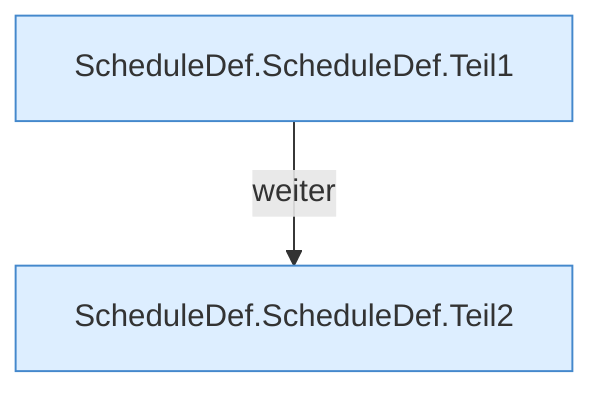

[[00 Start]] › [[Zeitplaene]] › [[Plan-Klassen]] › [[ScheduleDef]] › [[ScheduleDef.Teil1]] › [[ScheduleDef.ScheduleDef]]

# ScheduleDef.ScheduleDef

`ScheduleDef.ScheduleDef()` [src/main/java/de/aichele/childlauncher/ScheduleDef.java:57–75](https://github.com/Sciddie/minecraft-serverhoster-plugin/blob/95b02b953b0b4c23673e900e021a7c3c844aa37d/src/main/java/de/aichele/childlauncher/ScheduleDef.java#L57-L75)

- `ScheduleDef` in `src/main/java/de/aichele/childlauncher/ScheduleDef.java`
