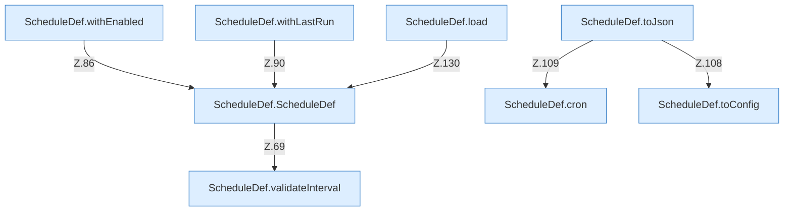

[[00 Start]] › [[Zeitplaene]] › [[Plan-Klassen]] › [[ScheduleDef]] › [[ScheduleDef.Teil1]]

# ScheduleDef.Teil1



```knoten
ScheduleDef.ScheduleDef
  Der [[Glossar#Zeitplan|Zeitplan]] plant hier einen Schritt. Eine Ebene tiefer steht er genauer. Plant `ScheduleDef`. Ruft `validateInterval`.
ScheduleDef.cron
  Der [[Glossar#Zeitplan|Zeitplan]] macht hier einen einzelnen Schritt. Eine Ebene tiefer steht er genauer. `cron` in `ScheduleDef.java`.
ScheduleDef.withEnabled
  Der [[Glossar#Zeitplan|Zeitplan]] macht hier einen einzelnen Schritt. Eine Ebene tiefer steht er genauer. Liefert eine Kopie mit `withEnabled`. Ruft `ScheduleDef`.
ScheduleDef.withLastRun
  Der [[Glossar#Zeitplan|Zeitplan]] kümmert sich um den letzten Stand den Lauf. Liefert eine Kopie mit `withLastRun`. Ruft `ScheduleDef`.
ScheduleDef.toConfig
  Der [[Glossar#Zeitplan|Zeitplan]] kümmert sich um die [[Glossar#Einstellungen|Einstellungen]]. `toConfig` in `ScheduleDef.java`. Ruft `toConfig`.
ScheduleDef.toJson
  Der [[Glossar#Zeitplan|Zeitplan]] kümmert sich um die Antwort. `toJson` in `ScheduleDef.java`. Ruft `toConfig`, `cron`.
ScheduleDef.load
  Der [[Glossar#Zeitplan|Zeitplan]] lädt das. Lädt `load`. Ruft `asMap`, `Action`, `string`.
ScheduleDef.validateInterval
  Der [[Glossar#Zeitplan|Zeitplan]] prüft hier einen Schritt. Eine Ebene tiefer steht er genauer. Prüft `validateInterval`.
```

> [!knoten]- Was die Blöcke tun
> - **ScheduleDef.ScheduleDef**: Der [[Glossar#Zeitplan|Zeitplan]] plant hier einen Schritt. Eine Ebene tiefer steht er genauer. Plant `ScheduleDef`. Ruft `validateInterval`.
> - **ScheduleDef.cron**: Der [[Glossar#Zeitplan|Zeitplan]] macht hier einen einzelnen Schritt. Eine Ebene tiefer steht er genauer. `cron` in `ScheduleDef.java`.
> - **ScheduleDef.withEnabled**: Der [[Glossar#Zeitplan|Zeitplan]] macht hier einen einzelnen Schritt. Eine Ebene tiefer steht er genauer. Liefert eine Kopie mit `withEnabled`. Ruft `ScheduleDef`.
> - **ScheduleDef.withLastRun**: Der [[Glossar#Zeitplan|Zeitplan]] kümmert sich um den letzten Stand den Lauf. Liefert eine Kopie mit `withLastRun`. Ruft `ScheduleDef`.
> - **ScheduleDef.toConfig**: Der [[Glossar#Zeitplan|Zeitplan]] kümmert sich um die [[Glossar#Einstellungen|Einstellungen]]. `toConfig` in `ScheduleDef.java`. Ruft `toConfig`.
> - **ScheduleDef.toJson**: Der [[Glossar#Zeitplan|Zeitplan]] kümmert sich um die Antwort. `toJson` in `ScheduleDef.java`. Ruft `toConfig`, `cron`.
> - **ScheduleDef.load**: Der [[Glossar#Zeitplan|Zeitplan]] lädt das. Lädt `load`. Ruft `asMap`, `Action`, `string`.
> - **ScheduleDef.validateInterval**: Der [[Glossar#Zeitplan|Zeitplan]] prüft hier einen Schritt. Eine Ebene tiefer steht er genauer. Prüft `validateInterval`.

- Ein weiterer Abschnitt derselben Übersicht.
