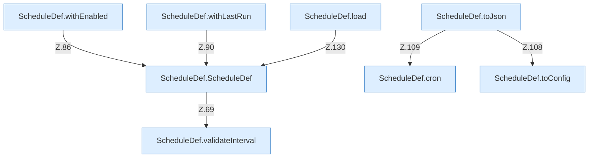

[[00 Start]] › [[Zeitplaene]] › [[Plan-Klassen]] › [[ScheduleDef]] › [[ScheduleDef.Teil1]]

# ScheduleDef.Teil1



```knoten
ScheduleDef.ScheduleDef
  Plant `ScheduleDef`. Ruft `validateInterval`.
ScheduleDef.cron
  `cron` in `ScheduleDef.java`.
ScheduleDef.withEnabled
  Liefert eine Kopie mit `withEnabled`. Ruft `ScheduleDef`.
ScheduleDef.withLastRun
  Liefert eine Kopie mit `withLastRun`. Ruft `ScheduleDef`.
ScheduleDef.toConfig
  `toConfig` in `ScheduleDef.java`. Ruft `toConfig`.
ScheduleDef.toJson
  `toJson` in `ScheduleDef.java`. Ruft `toConfig`, `cron`.
ScheduleDef.load
  Lädt `load`. Ruft `asMap`, `Action`, `string`.
ScheduleDef.validateInterval
  Prüft `validateInterval`.
```


