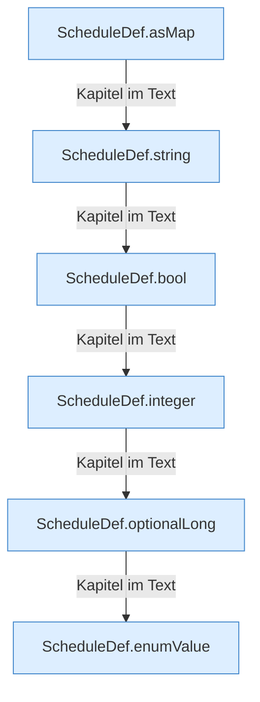

[[00 Start]] › [[Zeitplaene]] › [[Plan-Klassen]] › [[ScheduleDef]] › [[ScheduleDef.Teil2]]

# ScheduleDef.Teil2



```knoten
ScheduleDef.asMap
  Der [[Glossar#Zeitplan|Zeitplan]] kümmert sich um die Übersicht. `asMap` in `ScheduleDef.java`.
ScheduleDef.string
  Der [[Glossar#Zeitplan|Zeitplan]] macht hier einen einzelnen Schritt. Eine Ebene tiefer steht er genauer. `string` in `ScheduleDef.java`.
ScheduleDef.bool
  Der [[Glossar#Zeitplan|Zeitplan]] macht hier einen einzelnen Schritt. Eine Ebene tiefer steht er genauer. `bool` in `ScheduleDef.java`.
ScheduleDef.integer
  Der [[Glossar#Zeitplan|Zeitplan]] macht hier einen einzelnen Schritt. Eine Ebene tiefer steht er genauer. `integer` in `ScheduleDef.java`.
ScheduleDef.optionalLong
  Der [[Glossar#Zeitplan|Zeitplan]] kümmert sich um eine Zahl. Liest optional `optionalLong`.
ScheduleDef.enumValue
  Der [[Glossar#Zeitplan|Zeitplan]] kümmert sich um den Wert. `enumValue` in `ScheduleDef.java`.
```

> [!knoten]- Was die Blöcke tun
> - **ScheduleDef.asMap**: Der [[Glossar#Zeitplan|Zeitplan]] kümmert sich um die Übersicht. `asMap` in `ScheduleDef.java`.
> - **ScheduleDef.string**: Der [[Glossar#Zeitplan|Zeitplan]] macht hier einen einzelnen Schritt. Eine Ebene tiefer steht er genauer. `string` in `ScheduleDef.java`.
> - **ScheduleDef.bool**: Der [[Glossar#Zeitplan|Zeitplan]] macht hier einen einzelnen Schritt. Eine Ebene tiefer steht er genauer. `bool` in `ScheduleDef.java`.
> - **ScheduleDef.integer**: Der [[Glossar#Zeitplan|Zeitplan]] macht hier einen einzelnen Schritt. Eine Ebene tiefer steht er genauer. `integer` in `ScheduleDef.java`.
> - **ScheduleDef.optionalLong**: Der [[Glossar#Zeitplan|Zeitplan]] kümmert sich um eine Zahl. Liest optional `optionalLong`.
> - **ScheduleDef.enumValue**: Der [[Glossar#Zeitplan|Zeitplan]] kümmert sich um den Wert. `enumValue` in `ScheduleDef.java`.

- Ein weiterer Abschnitt derselben Übersicht.
