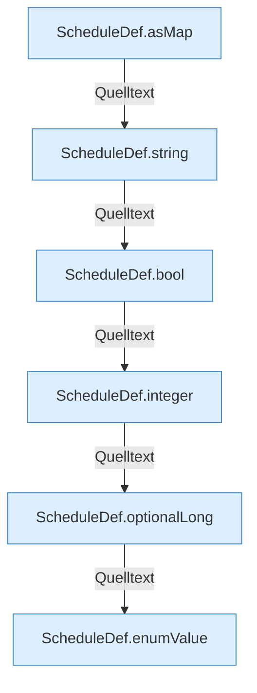

[[00 Start]] › [[Zeitplaene]] › [[Plan-Klassen]] › [[ScheduleDef]] › [[ScheduleDef.Teil2]]

# ScheduleDef.Teil2



```knoten
ScheduleDef.asMap
  `asMap` in `ScheduleDef.java`.
ScheduleDef.string
  `string` in `ScheduleDef.java`.
ScheduleDef.bool
  `bool` in `ScheduleDef.java`.
ScheduleDef.integer
  `integer` in `ScheduleDef.java`.
ScheduleDef.optionalLong
  Liest optional `optionalLong`.
ScheduleDef.enumValue
  `enumValue` in `ScheduleDef.java`.
```


