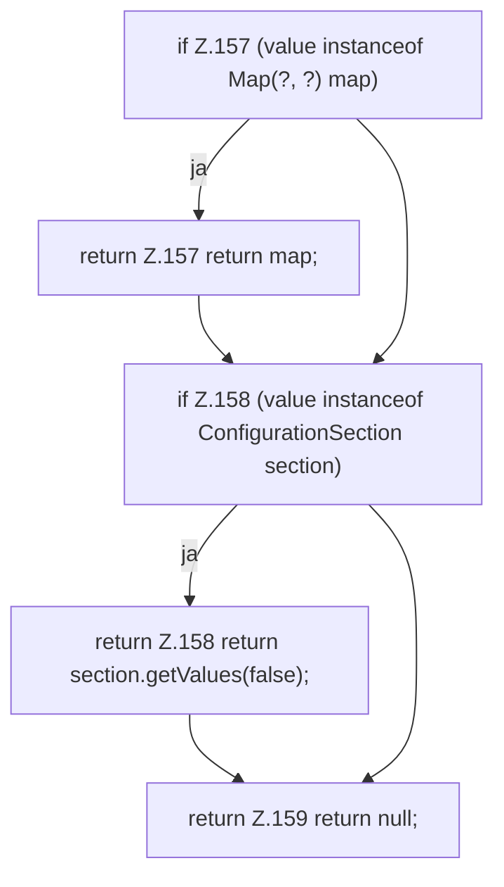

[[00 Start]] › [[Zeitplaene]] › [[Plan-Klassen]] › [[ScheduleDef]] › [[ScheduleDef.Teil2]] › [[ScheduleDef.asMap]]

# ScheduleDef.asMap

`ScheduleDef.asMap(Object value)` [src/main/java/de/aichele/childlauncher/ScheduleDef.java:156–160](https://github.com/Sciddie/minecraft-serverhoster-plugin/blob/95b02b953b0b4c23673e900e021a7c3c844aa37d/src/main/java/de/aichele/childlauncher/ScheduleDef.java#L156-L160)



```knoten
if Z.157 (value instanceof Map(?, ?) map)
  Zeile 157: prüft `(value instanceof Map(?, ?) map)`.
return Z.157 return map;
  Zeile 157: Rückgabe `return map;`.
if Z.158 (value instanceof ConfigurationSection section)
  Zeile 158: prüft `(value instanceof ConfigurationSection section)`.
return Z.158 return section.getValues(false);
  Zeile 158: Rückgabe `return section.getValues(false);`.
return Z.159 return null;
  Zeile 159: Rückgabe `return null;`.
```

- `asMap` in `src/main/java/de/aichele/childlauncher/ScheduleDef.java`
