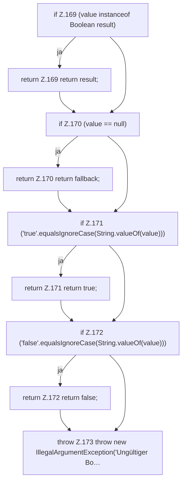

[[00 Start]] › [[Zeitplaene]] › [[Plan-Klassen]] › [[ScheduleDef]] › [[ScheduleDef.Teil2]] › [[ScheduleDef.bool]]

# ScheduleDef.bool

`ScheduleDef.bool(Map<?, ?> map, String key, boolean fallback)` [src/main/java/de/aichele/childlauncher/ScheduleDef.java:167–174](https://github.com/Sciddie/minecraft-serverhoster-plugin/blob/95b02b953b0b4c23673e900e021a7c3c844aa37d/src/main/java/de/aichele/childlauncher/ScheduleDef.java#L167-L174)



```knoten
if Z.169 (value instanceof Boolean result)
  Zeile 169: prüft `(value instanceof Boolean result)`.
return Z.169 return result;
  Zeile 169: Rückgabe `return result;`.
if Z.170 (value == null)
  Zeile 170: prüft `(value == null)`.
return Z.170 return fallback;
  Zeile 170: Rückgabe `return fallback;`.
if Z.171 ('true'.equalsIgnoreCase(String.valueOf(value)))
  Zeile 171: prüft `('true'.equalsIgnoreCase(String.valueOf(value)))`.
return Z.171 return true;
  Zeile 171: Rückgabe `return true;`.
if Z.172 ('false'.equalsIgnoreCase(String.valueOf(value)))
  Zeile 172: prüft `('false'.equalsIgnoreCase(String.valueOf(value)))`.
return Z.172 return false;
  Zeile 172: Rückgabe `return false;`.
throw Z.173 throw new IllegalArgumentException('Ungültiger Bo…
  Zeile 173: Abbruch `throw new IllegalArgumentException('Ungültiger Bo…`.
```

> [!knoten]- Was die Blöcke tun
> - **if Z.169 (value instanceof Boolean result)**: Zeile 169: prüft `(value instanceof Boolean result)`.
> - **return Z.169 return result;**: Zeile 169: Rückgabe `return result;`.
> - **if Z.170 (value == null)**: Zeile 170: prüft `(value == null)`.
> - **return Z.170 return fallback;**: Zeile 170: Rückgabe `return fallback;`.
> - **if Z.171 ('true'.equalsIgnoreCase(String.valueOf(value)))**: Zeile 171: prüft `('true'.equalsIgnoreCase(String.valueOf(value)))`.
> - **return Z.171 return true;**: Zeile 171: Rückgabe `return true;`.
> - **if Z.172 ('false'.equalsIgnoreCase(String.valueOf(value)))**: Zeile 172: prüft `('false'.equalsIgnoreCase(String.valueOf(value)))`.
> - **return Z.172 return false;**: Zeile 172: Rückgabe `return false;`.
> - **throw Z.173 throw new IllegalArgumentException('Ungültiger Bo…**: Zeile 173: Abbruch `throw new IllegalArgumentException('Ungültiger Bo…`.

- Der [[Glossar#Zeitplan|Zeitplan]] macht hier einen einzelnen Schritt. Eine Ebene tiefer steht er genauer.
- `bool` in `src/main/java/de/aichele/childlauncher/ScheduleDef.java`
