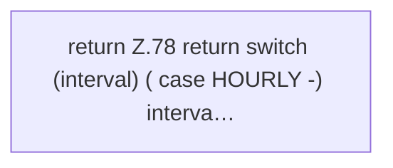

[[00 Start]] › [[Zeitplaene]] › [[Plan-Klassen]] › [[ScheduleDef]] › [[ScheduleDef.Teil1]] › [[ScheduleDef.cron]]

# ScheduleDef.cron

`ScheduleDef.cron()` [src/main/java/de/aichele/childlauncher/ScheduleDef.java:77–83](https://github.com/Sciddie/minecraft-serverhoster-plugin/blob/95b02b953b0b4c23673e900e021a7c3c844aa37d/src/main/java/de/aichele/childlauncher/ScheduleDef.java#L77-L83)



```knoten
return Z.78 return switch (interval) ( case HOURLY -) interva…
  Zeile 78: Rückgabe `return switch (interval) ( case HOURLY -) interva…`.
```

> [!knoten]- Was die Blöcke tun
> - **return Z.78 return switch (interval) ( case HOURLY -) interva…**: Zeile 78: Rückgabe `return switch (interval) ( case HOURLY -) interva…`.

- Der [[Glossar#Zeitplan|Zeitplan]] macht hier einen einzelnen Schritt. Eine Ebene tiefer steht er genauer.
- `cron` in `src/main/java/de/aichele/childlauncher/ScheduleDef.java`
