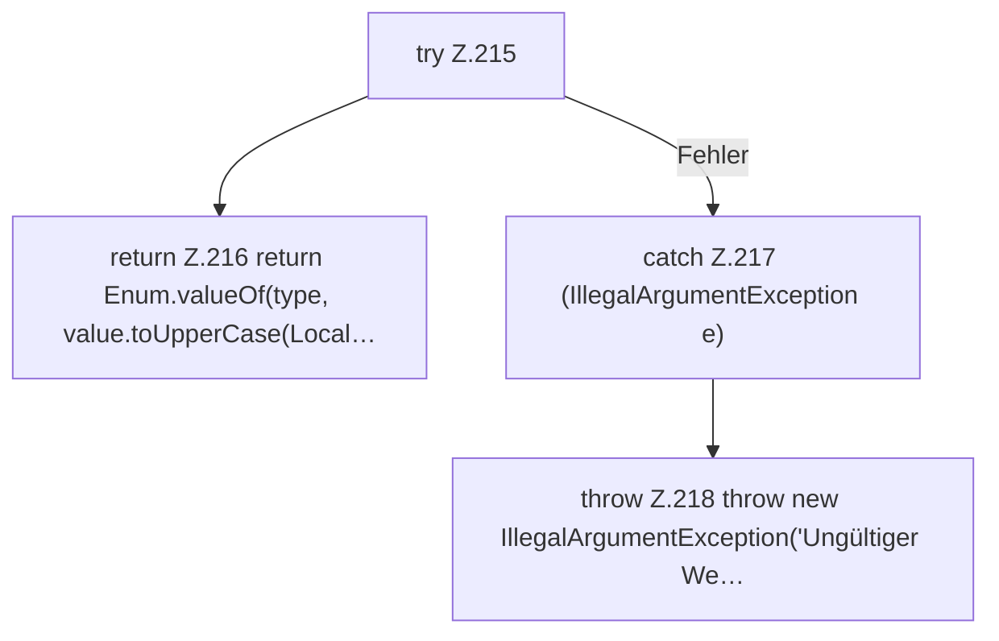

[[00 Start]] › [[Zeitplaene]] › [[Plan-Klassen]] › [[ScheduleDef]] › [[ScheduleDef.Teil2]] › [[ScheduleDef.enumValue]]

# ScheduleDef.enumValue

`ScheduleDef.enumValue(String value, Class<T> type)` [src/main/java/de/aichele/childlauncher/ScheduleDef.java:214–220](https://github.com/Sciddie/minecraft-serverhoster-plugin/blob/95b02b953b0b4c23673e900e021a7c3c844aa37d/src/main/java/de/aichele/childlauncher/ScheduleDef.java#L214-L220)



```knoten
try Z.215
  Zeile 215: Versuch. Der Fehlerpfad geht in catch.
return Z.216 return Enum.valueOf(type, value.toUpperCase(Local…
  Zeile 216: Rückgabe `return Enum.valueOf(type, value.toUpperCase(Local…`.
catch Z.217 (IllegalArgumentException e)
  Zeile 217: fängt (IllegalArgumentException e).
throw Z.218 throw new IllegalArgumentException('Ungültiger We…
  Zeile 218: Abbruch `throw new IllegalArgumentException('Ungültiger We…`.
```

> [!knoten]- Was die Blöcke tun
> - **try Z.215**: Zeile 215: Versuch. Der Fehlerpfad geht in catch.
> - **return Z.216 return Enum.valueOf(type, value.toUpperCase(Local…**: Zeile 216: Rückgabe `return Enum.valueOf(type, value.toUpperCase(Local…`.
> - **catch Z.217 (IllegalArgumentException e)**: Zeile 217: fängt (IllegalArgumentException e).
> - **throw Z.218 throw new IllegalArgumentException('Ungültiger We…**: Zeile 218: Abbruch `throw new IllegalArgumentException('Ungültiger We…`.

- Der [[Glossar#Zeitplan|Zeitplan]] kümmert sich um den Wert.
- `enumValue` in `src/main/java/de/aichele/childlauncher/ScheduleDef.java`
