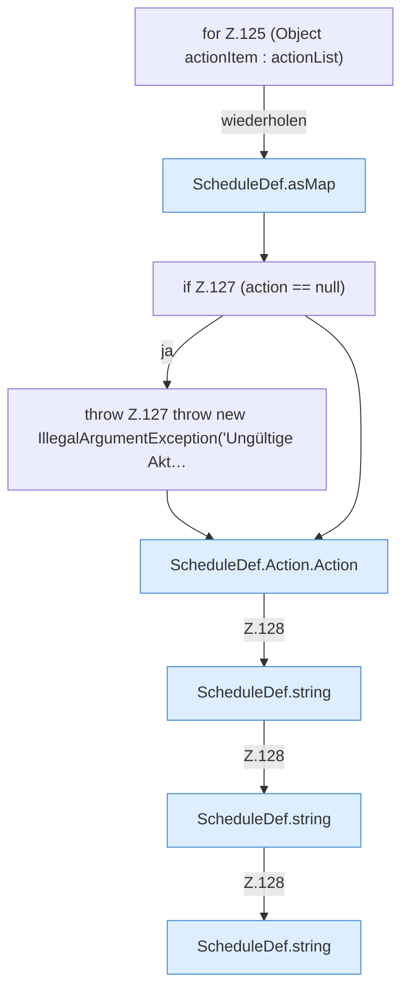

[[00 Start]] › [[Zeitplaene]] › [[Plan-Klassen]] › [[ScheduleDef]] › [[ScheduleDef.Teil1]] › [[ScheduleDef.load]] › [[ScheduleDef.load.Z118.Teil1.Z125]]

# ScheduleDef.load.Z118.Teil1.Z125



```knoten
for Z.125 (Object actionItem : actionList)
  Zeile 125: Schleife `(Object actionItem : actionList)`.
ScheduleDef.asMap
  Der [[Glossar#Zeitplan|Zeitplan]] kümmert sich um die Übersicht. `asMap` in `ScheduleDef.java`.
if Z.127 (action == null)
  Zeile 127: prüft `(action == null)`.
throw Z.127 throw new IllegalArgumentException('Ungültige Akt…
  Zeile 127: Abbruch `throw new IllegalArgumentException('Ungültige Akt…`.
ScheduleDef.Action.Action
  Der [[Glossar#Zeitplan|Zeitplan]] macht hier einen einzelnen Schritt. Eine Ebene tiefer steht er genauer. `Action` in `ScheduleDef.java`.
ScheduleDef.string
  Der [[Glossar#Zeitplan|Zeitplan]] macht hier einen einzelnen Schritt. Eine Ebene tiefer steht er genauer. `string` in `ScheduleDef.java`.
```

> [!knoten]- Was die Blöcke tun
> - **for Z.125 (Object actionItem : actionList)**: Zeile 125: Schleife `(Object actionItem : actionList)`.
> - **ScheduleDef.asMap**: Der [[Glossar#Zeitplan|Zeitplan]] kümmert sich um die Übersicht. `asMap` in `ScheduleDef.java`.
> - **if Z.127 (action == null)**: Zeile 127: prüft `(action == null)`.
> - **throw Z.127 throw new IllegalArgumentException('Ungültige Akt…**: Zeile 127: Abbruch `throw new IllegalArgumentException('Ungültige Akt…`.
> - **ScheduleDef.Action.Action**: Der [[Glossar#Zeitplan|Zeitplan]] macht hier einen einzelnen Schritt. Eine Ebene tiefer steht er genauer. `Action` in `ScheduleDef.java`.
> - **ScheduleDef.string**: Der [[Glossar#Zeitplan|Zeitplan]] macht hier einen einzelnen Schritt. Eine Ebene tiefer steht er genauer. `string` in `ScheduleDef.java`.

- Der Ablauf geht in [[Glossar#Zeile|Zeile]] 125 weiter. Eine Ebene tiefer steht er genauer.
- Fortsetzung von `ScheduleDef.load.Z118.Teil1`.
