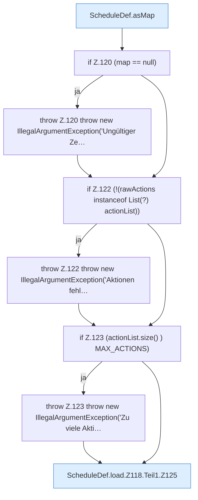

[[00 Start]] › [[Zeitplaene]] › [[Plan-Klassen]] › [[ScheduleDef]] › [[ScheduleDef.Teil1]] › [[ScheduleDef.load]] › [[ScheduleDef.load.Z118.Teil1]]

# ScheduleDef.load.Z118.Teil1



```knoten
ScheduleDef.asMap
  Der [[Glossar#Zeitplan|Zeitplan]] kümmert sich um die Übersicht. `asMap` in `ScheduleDef.java`.
if Z.120 (map == null)
  Zeile 120: prüft `(map == null)`.
throw Z.120 throw new IllegalArgumentException('Ungültiger Ze…
  Zeile 120: Abbruch `throw new IllegalArgumentException('Ungültiger Ze…`.
if Z.122 (!(rawActions instanceof List(?) actionList))
  Zeile 122: prüft `(!(rawActions instanceof List(?) actionList))`.
throw Z.122 throw new IllegalArgumentException('Aktionen fehl…
  Zeile 122: Abbruch `throw new IllegalArgumentException('Aktionen fehl…`.
if Z.123 (actionList.size() ) MAX_ACTIONS)
  Zeile 123: prüft `(actionList.size() ) MAX_ACTIONS)`.
throw Z.123 throw new IllegalArgumentException('Zu viele Akti…
  Zeile 123: Abbruch `throw new IllegalArgumentException('Zu viele Akti…`.
ScheduleDef.load.Z118.Teil1.Z125
  Der Ablauf geht in [[Glossar#Zeile|Zeile]] 125 weiter. Eine Ebene tiefer steht er genauer. Fortsetzung des Ablaufs ab Zeile 125.
```

> [!knoten]- Was die Blöcke tun
> - **ScheduleDef.asMap**: Der [[Glossar#Zeitplan|Zeitplan]] kümmert sich um die Übersicht. `asMap` in `ScheduleDef.java`.
> - **if Z.120 (map == null)**: Zeile 120: prüft `(map == null)`.
> - **throw Z.120 throw new IllegalArgumentException('Ungültiger Ze…**: Zeile 120: Abbruch `throw new IllegalArgumentException('Ungültiger Ze…`.
> - **if Z.122 (!(rawActions instanceof List(?) actionList))**: Zeile 122: prüft `(!(rawActions instanceof List(?) actionList))`.
> - **throw Z.122 throw new IllegalArgumentException('Aktionen fehl…**: Zeile 122: Abbruch `throw new IllegalArgumentException('Aktionen fehl…`.
> - **if Z.123 (actionList.size() ) MAX_ACTIONS)**: Zeile 123: prüft `(actionList.size() ) MAX_ACTIONS)`.
> - **throw Z.123 throw new IllegalArgumentException('Zu viele Akti…**: Zeile 123: Abbruch `throw new IllegalArgumentException('Zu viele Akti…`.
> - **ScheduleDef.load.Z118.Teil1.Z125**: Der Ablauf geht in [[Glossar#Zeile|Zeile]] 125 weiter. Eine Ebene tiefer steht er genauer. Fortsetzung des Ablaufs ab Zeile 125.

- Ein weiterer Abschnitt derselben Übersicht.
- Fortsetzung von `ScheduleDef.load.Z118`.
