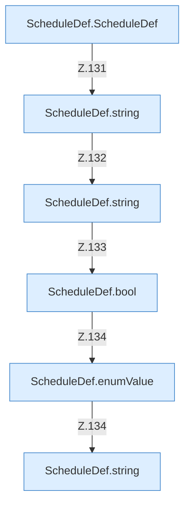

[[00 Start]] › [[Zeitplaene]] › [[Plan-Klassen]] › [[ScheduleDef]] › [[ScheduleDef.Teil1]] › [[ScheduleDef.load]] › [[ScheduleDef.load.Z118.Teil2.Calls5700]]

# ScheduleDef.load.Z118.Teil2.Calls5700



```knoten
ScheduleDef.ScheduleDef
  Plant `ScheduleDef`. Ruft `validateInterval`.
ScheduleDef.string
  `string` in `ScheduleDef.java`.
ScheduleDef.bool
  `bool` in `ScheduleDef.java`.
ScheduleDef.enumValue
  `enumValue` in `ScheduleDef.java`.
```

- Fortsetzung von `ScheduleDef.load.Z118.Teil2`, Quellreihenfolge.
