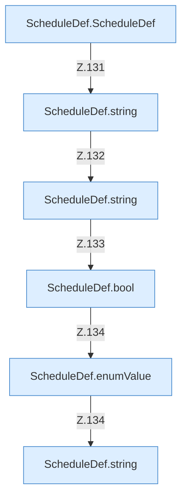

[[00 Start]] › [[Zeitplaene]] › [[Plan-Klassen]] › [[ScheduleDef]] › [[ScheduleDef.Teil1]] › [[ScheduleDef.load]] › [[ScheduleDef.load.Z118.Teil2.Calls5700]]

# ScheduleDef.load.Z118.Teil2.Calls5700



```knoten
ScheduleDef.ScheduleDef
  Der [[Glossar#Zeitplan|Zeitplan]] plant hier einen Schritt. Eine Ebene tiefer steht er genauer. Plant `ScheduleDef`. Ruft `validateInterval`.
ScheduleDef.string
  Der [[Glossar#Zeitplan|Zeitplan]] macht hier einen einzelnen Schritt. Eine Ebene tiefer steht er genauer. `string` in `ScheduleDef.java`.
ScheduleDef.bool
  Der [[Glossar#Zeitplan|Zeitplan]] macht hier einen einzelnen Schritt. Eine Ebene tiefer steht er genauer. `bool` in `ScheduleDef.java`.
ScheduleDef.enumValue
  Der [[Glossar#Zeitplan|Zeitplan]] kümmert sich um den Wert. `enumValue` in `ScheduleDef.java`.
```

> [!knoten]- Was die Blöcke tun
> - **ScheduleDef.ScheduleDef**: Der [[Glossar#Zeitplan|Zeitplan]] plant hier einen Schritt. Eine Ebene tiefer steht er genauer. Plant `ScheduleDef`. Ruft `validateInterval`.
> - **ScheduleDef.string**: Der [[Glossar#Zeitplan|Zeitplan]] macht hier einen einzelnen Schritt. Eine Ebene tiefer steht er genauer. `string` in `ScheduleDef.java`.
> - **ScheduleDef.bool**: Der [[Glossar#Zeitplan|Zeitplan]] macht hier einen einzelnen Schritt. Eine Ebene tiefer steht er genauer. `bool` in `ScheduleDef.java`.
> - **ScheduleDef.enumValue**: Der [[Glossar#Zeitplan|Zeitplan]] kümmert sich um den Wert. `enumValue` in `ScheduleDef.java`.

- Weitere [[Glossar#Funktion|Funktionen]], die ab [[Glossar#Zeile|Zeile]] 5700 aufgerufen werden.
- Fortsetzung von `ScheduleDef.load.Z118.Teil2`.
