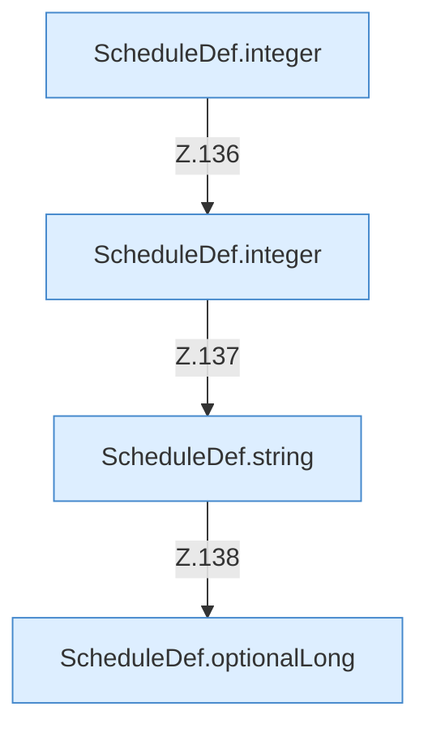

[[00 Start]] › [[Zeitplaene]] › [[Plan-Klassen]] › [[ScheduleDef]] › [[ScheduleDef.Teil1]] › [[ScheduleDef.load]] › [[ScheduleDef.load.Z118.Teil2.Calls5946]]

# ScheduleDef.load.Z118.Teil2.Calls5946



```knoten
ScheduleDef.integer
  Der [[Glossar#Zeitplan|Zeitplan]] macht hier einen einzelnen Schritt. Eine Ebene tiefer steht er genauer. `integer` in `ScheduleDef.java`.
ScheduleDef.string
  Der [[Glossar#Zeitplan|Zeitplan]] macht hier einen einzelnen Schritt. Eine Ebene tiefer steht er genauer. `string` in `ScheduleDef.java`.
ScheduleDef.optionalLong
  Der [[Glossar#Zeitplan|Zeitplan]] kümmert sich um eine Zahl. Liest optional `optionalLong`.
```

> [!knoten]- Was die Blöcke tun
> - **ScheduleDef.integer**: Der [[Glossar#Zeitplan|Zeitplan]] macht hier einen einzelnen Schritt. Eine Ebene tiefer steht er genauer. `integer` in `ScheduleDef.java`.
> - **ScheduleDef.string**: Der [[Glossar#Zeitplan|Zeitplan]] macht hier einen einzelnen Schritt. Eine Ebene tiefer steht er genauer. `string` in `ScheduleDef.java`.
> - **ScheduleDef.optionalLong**: Der [[Glossar#Zeitplan|Zeitplan]] kümmert sich um eine Zahl. Liest optional `optionalLong`.

- Weitere [[Glossar#Funktion|Funktionen]], die ab [[Glossar#Zeile|Zeile]] 5946 aufgerufen werden.
- Fortsetzung von `ScheduleDef.load.Z118.Teil2`.
