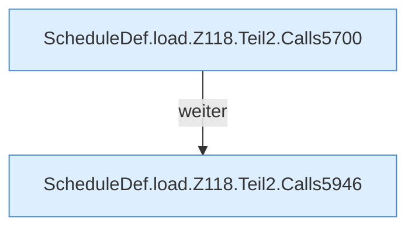

[[00 Start]] › [[Zeitplaene]] › [[Plan-Klassen]] › [[ScheduleDef]] › [[ScheduleDef.Teil1]] › [[ScheduleDef.load]] › [[ScheduleDef.load.Z118.Teil2]]

# ScheduleDef.load.Z118.Teil2

- Fortsetzung von `ScheduleDef.load.Z118`, Quellreihenfolge.
