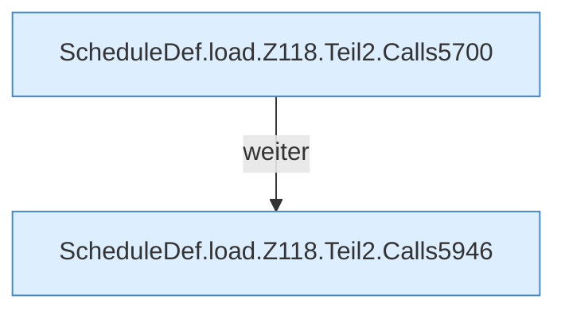

[[00 Start]] › [[Zeitplaene]] › [[Plan-Klassen]] › [[ScheduleDef]] › [[ScheduleDef.Teil1]] › [[ScheduleDef.load]] › [[ScheduleDef.load.Z118.Teil2]]

# ScheduleDef.load.Z118.Teil2



```knoten
ScheduleDef.load.Z118.Teil2.Calls5700
  Weitere [[Glossar#Funktion|Funktionen]], die ab [[Glossar#Zeile|Zeile]] 5700 aufgerufen werden. Weitere eigene Aufrufe ab Zeile 5700.
ScheduleDef.load.Z118.Teil2.Calls5946
  Weitere [[Glossar#Funktion|Funktionen]], die ab [[Glossar#Zeile|Zeile]] 5946 aufgerufen werden. Weitere eigene Aufrufe ab Zeile 5946.
```

> [!knoten]- Was die Blöcke tun
> - **ScheduleDef.load.Z118.Teil2.Calls5700**: Weitere [[Glossar#Funktion|Funktionen]], die ab [[Glossar#Zeile|Zeile]] 5700 aufgerufen werden. Weitere eigene Aufrufe ab Zeile 5700.
> - **ScheduleDef.load.Z118.Teil2.Calls5946**: Weitere [[Glossar#Funktion|Funktionen]], die ab [[Glossar#Zeile|Zeile]] 5946 aufgerufen werden. Weitere eigene Aufrufe ab Zeile 5946.

- Ein weiterer Abschnitt derselben Übersicht.
- Fortsetzung von `ScheduleDef.load.Z118`.
