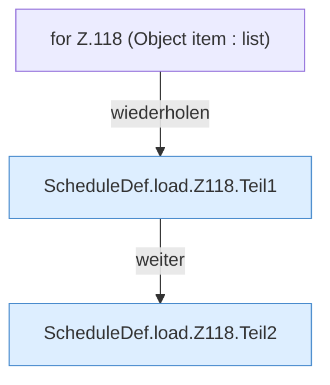

[[00 Start]] › [[Zeitplaene]] › [[Plan-Klassen]] › [[ScheduleDef]] › [[ScheduleDef.Teil1]] › [[ScheduleDef.load]] › [[ScheduleDef.load.Z118]]

# ScheduleDef.load.Z118



```knoten
for Z.118 (Object item : list)
  Zeile 118: Schleife `(Object item : list)`.
ScheduleDef.load.Z118.Teil1
  Abschnitt 1 dieses Ablaufs, in Quellreihenfolge.
ScheduleDef.load.Z118.Teil2
  Abschnitt 2 dieses Ablaufs, in Quellreihenfolge.
```

- Fortsetzung von `ScheduleDef.load`, Quellreihenfolge.
