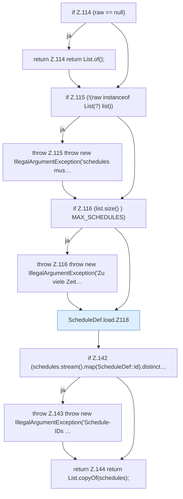

[[00 Start]] › [[Zeitplaene]] › [[Plan-Klassen]] › [[ScheduleDef]] › [[ScheduleDef.Teil1]] › [[ScheduleDef.load]]

# ScheduleDef.load

`ScheduleDef.load(Object raw)` [src/main/java/de/aichele/childlauncher/ScheduleDef.java:113–145](https://github.com/Sciddie/minecraft-serverhoster-plugin/blob/95b02b953b0b4c23673e900e021a7c3c844aa37d/src/main/java/de/aichele/childlauncher/ScheduleDef.java#L113-L145)



```knoten
if Z.114 (raw == null)
  Zeile 114: prüft `(raw == null)`.
return Z.114 return List.of();
  Zeile 114: Rückgabe `return List.of();`.
if Z.115 (!(raw instanceof List(?) list))
  Zeile 115: prüft `(!(raw instanceof List(?) list))`.
throw Z.115 throw new IllegalArgumentException('schedules mus…
  Zeile 115: Abbruch `throw new IllegalArgumentException('schedules mus…`.
if Z.116 (list.size() ) MAX_SCHEDULES)
  Zeile 116: prüft `(list.size() ) MAX_SCHEDULES)`.
throw Z.116 throw new IllegalArgumentException('Zu viele Zeit…
  Zeile 116: Abbruch `throw new IllegalArgumentException('Zu viele Zeit…`.
ScheduleDef.load.Z118
  Der Ablauf geht in [[Glossar#Zeile|Zeile]] 118 weiter. Eine Ebene tiefer steht er genauer. Fortsetzung des Ablaufs ab Zeile 118.
if Z.142 (schedules.stream().map(ScheduleDef::id).distinct…
  Zeile 142: prüft `(schedules.stream().map(ScheduleDef::id).distinct…`.
throw Z.143 throw new IllegalArgumentException('Schedule-IDs …
  Zeile 143: Abbruch `throw new IllegalArgumentException('Schedule-IDs …`.
return Z.144 return List.copyOf(schedules);
  Zeile 144: Rückgabe `return List.copyOf(schedules);`.
```

> [!knoten]- Was die Blöcke tun
> - **if Z.114 (raw == null)**: Zeile 114: prüft `(raw == null)`.
> - **return Z.114 return List.of();**: Zeile 114: Rückgabe `return List.of();`.
> - **if Z.115 (!(raw instanceof List(?) list))**: Zeile 115: prüft `(!(raw instanceof List(?) list))`.
> - **throw Z.115 throw new IllegalArgumentException('schedules mus…**: Zeile 115: Abbruch `throw new IllegalArgumentException('schedules mus…`.
> - **if Z.116 (list.size() ) MAX_SCHEDULES)**: Zeile 116: prüft `(list.size() ) MAX_SCHEDULES)`.
> - **throw Z.116 throw new IllegalArgumentException('Zu viele Zeit…**: Zeile 116: Abbruch `throw new IllegalArgumentException('Zu viele Zeit…`.
> - **ScheduleDef.load.Z118**: Der Ablauf geht in [[Glossar#Zeile|Zeile]] 118 weiter. Eine Ebene tiefer steht er genauer. Fortsetzung des Ablaufs ab Zeile 118.
> - **if Z.142 (schedules.stream().map(ScheduleDef::id).distinct…**: Zeile 142: prüft `(schedules.stream().map(ScheduleDef::id).distinct…`.
> - **throw Z.143 throw new IllegalArgumentException('Schedule-IDs …**: Zeile 143: Abbruch `throw new IllegalArgumentException('Schedule-IDs …`.
> - **return Z.144 return List.copyOf(schedules);**: Zeile 144: Rückgabe `return List.copyOf(schedules);`.

- Der [[Glossar#Zeitplan|Zeitplan]] lädt das.
- `load` in `src/main/java/de/aichele/childlauncher/ScheduleDef.java`
