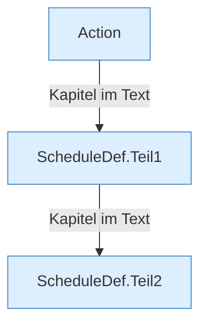

[[00 Start]] › [[Zeitplaene]] › [[Plan-Klassen]] › [[ScheduleDef]]

# ScheduleDef



```knoten
Action
  Die eine Tätigkeit in einem [[Glossar#Zeitplan|Zeitplan]], zum Beispiel ein [[Glossar#Befehl|Befehl]].
ScheduleDef.Teil1
  Ein weiterer Abschnitt derselben Übersicht. Im [[Glossar#Quelltext|Quelltext]] heißt das `Teil1`.
ScheduleDef.Teil2
  Ein weiterer Abschnitt derselben Übersicht. Im [[Glossar#Quelltext|Quelltext]] heißt das `Teil2`.
```

> [!knoten]- Was die Blöcke tun
> - **Action**: Die eine Tätigkeit in einem [[Glossar#Zeitplan|Zeitplan]], zum Beispiel ein [[Glossar#Befehl|Befehl]].
> - **ScheduleDef.Teil1**: Ein weiterer Abschnitt derselben Übersicht. Im [[Glossar#Quelltext|Quelltext]] heißt das `Teil1`.
> - **ScheduleDef.Teil2**: Ein weiterer Abschnitt derselben Übersicht. Im [[Glossar#Quelltext|Quelltext]] heißt das `Teil2`.

- Die Beschreibung eines [[Glossar#Zeitplan|Zeitplans]]: wann, was, und ob er an ist.
