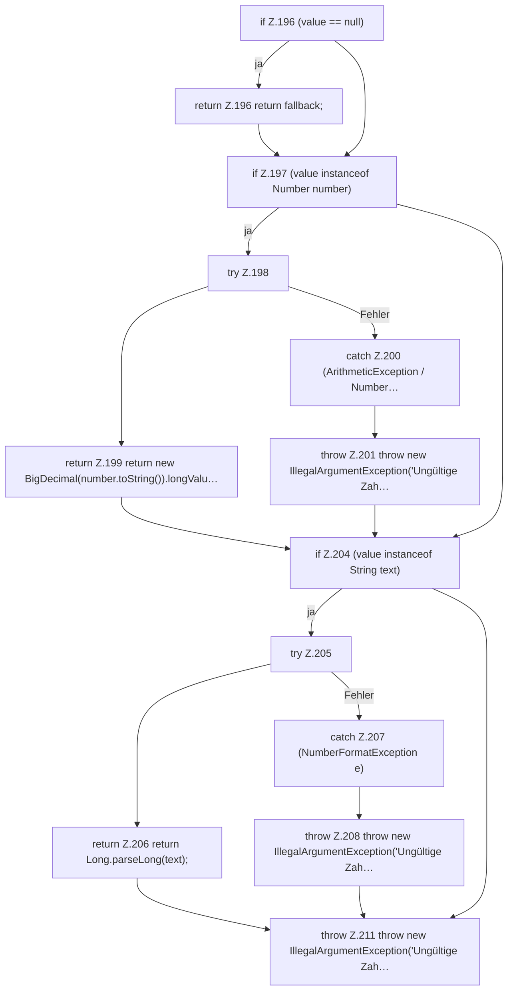

[[00 Start]] › [[Zeitplaene]] › [[Plan-Klassen]] › [[ScheduleDef]] › [[ScheduleDef.Teil2]] › [[ScheduleDef.optionalLong]]

# ScheduleDef.optionalLong

`ScheduleDef.optionalLong(Map<?, ?> map, String key, long fallback)` [src/main/java/de/aichele/childlauncher/ScheduleDef.java:194–212](https://github.com/Sciddie/minecraft-serverhoster-plugin/blob/95b02b953b0b4c23673e900e021a7c3c844aa37d/src/main/java/de/aichele/childlauncher/ScheduleDef.java#L194-L212)

- `optionalLong` in `src/main/java/de/aichele/childlauncher/ScheduleDef.java`
