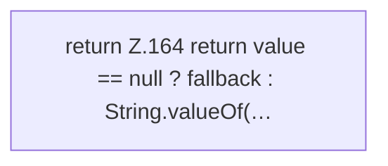

[[00 Start]] › [[Zeitplaene]] › [[Plan-Klassen]] › [[ScheduleDef]] › [[ScheduleDef.Teil2]] › [[ScheduleDef.string]]

# ScheduleDef.string

`ScheduleDef.string(Map<?, ?> map, String key, String fallback)` [src/main/java/de/aichele/childlauncher/ScheduleDef.java:162–165](https://github.com/Sciddie/minecraft-serverhoster-plugin/blob/95b02b953b0b4c23673e900e021a7c3c844aa37d/src/main/java/de/aichele/childlauncher/ScheduleDef.java#L162-L165)



```knoten
return Z.164 return value == null ? fallback : String.valueOf(…
  Zeile 164: Rückgabe `return value == null ? fallback : String.valueOf(…`.
```

- `string` in `src/main/java/de/aichele/childlauncher/ScheduleDef.java`
