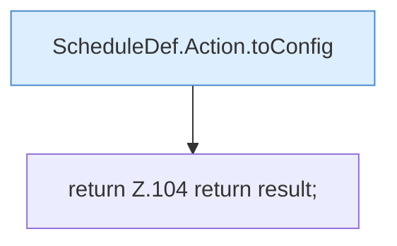

[[00 Start]] › [[Zeitplaene]] › [[Plan-Klassen]] › [[ScheduleDef]] › [[ScheduleDef.Teil1]] › [[ScheduleDef.toConfig]]

# ScheduleDef.toConfig

`ScheduleDef.toConfig()` [src/main/java/de/aichele/childlauncher/ScheduleDef.java:93–105](https://github.com/Sciddie/minecraft-serverhoster-plugin/blob/95b02b953b0b4c23673e900e021a7c3c844aa37d/src/main/java/de/aichele/childlauncher/ScheduleDef.java#L93-L105)



```knoten
ScheduleDef.Action.toConfig
  `toConfig` in `ScheduleDef.java`.
return Z.104 return result;
  Zeile 104: Rückgabe `return result;`.
```

- `toConfig` in `src/main/java/de/aichele/childlauncher/ScheduleDef.java`
