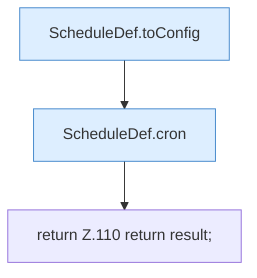

[[00 Start]] › [[Zeitplaene]] › [[Plan-Klassen]] › [[ScheduleDef]] › [[ScheduleDef.Teil1]] › [[ScheduleDef.toJson]]

# ScheduleDef.toJson

`ScheduleDef.toJson()` [src/main/java/de/aichele/childlauncher/ScheduleDef.java:107–111](https://github.com/Sciddie/minecraft-serverhoster-plugin/blob/95b02b953b0b4c23673e900e021a7c3c844aa37d/src/main/java/de/aichele/childlauncher/ScheduleDef.java#L107-L111)



```knoten
ScheduleDef.toConfig
  Der [[Glossar#Zeitplan|Zeitplan]] kümmert sich um die [[Glossar#Einstellungen|Einstellungen]]. `toConfig` in `ScheduleDef.java`. Ruft `toConfig`.
ScheduleDef.cron
  Der [[Glossar#Zeitplan|Zeitplan]] macht hier einen einzelnen Schritt. Eine Ebene tiefer steht er genauer. `cron` in `ScheduleDef.java`.
return Z.110 return result;
  Zeile 110: Rückgabe `return result;`.
```

> [!knoten]- Was die Blöcke tun
> - **ScheduleDef.toConfig**: Der [[Glossar#Zeitplan|Zeitplan]] kümmert sich um die [[Glossar#Einstellungen|Einstellungen]]. `toConfig` in `ScheduleDef.java`. Ruft `toConfig`.
> - **ScheduleDef.cron**: Der [[Glossar#Zeitplan|Zeitplan]] macht hier einen einzelnen Schritt. Eine Ebene tiefer steht er genauer. `cron` in `ScheduleDef.java`.
> - **return Z.110 return result;**: Zeile 110: Rückgabe `return result;`.

- Der [[Glossar#Zeitplan|Zeitplan]] kümmert sich um die Antwort.
- `toJson` in `src/main/java/de/aichele/childlauncher/ScheduleDef.java`
