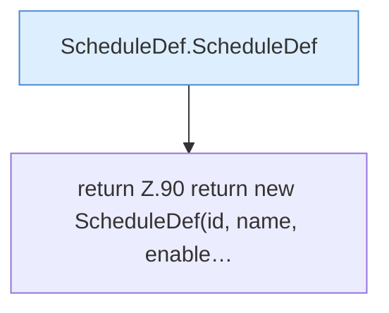

[[00 Start]] › [[Zeitplaene]] › [[Plan-Klassen]] › [[ScheduleDef]] › [[ScheduleDef.Teil1]] › [[ScheduleDef.withLastRun]]

# ScheduleDef.withLastRun

`ScheduleDef.withLastRun(long value)` [src/main/java/de/aichele/childlauncher/ScheduleDef.java:89–91](https://github.com/Sciddie/minecraft-serverhoster-plugin/blob/95b02b953b0b4c23673e900e021a7c3c844aa37d/src/main/java/de/aichele/childlauncher/ScheduleDef.java#L89-L91)



```knoten
ScheduleDef.ScheduleDef
  Plant `ScheduleDef`. Ruft `validateInterval`.
return Z.90 return new ScheduleDef(id, name, enable…
  Zeile 90: Rückgabe `return new ScheduleDef(id, name, enable…`.
```

- `withLastRun` in `src/main/java/de/aichele/childlauncher/ScheduleDef.java`
