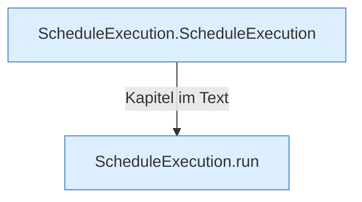

[[00 Start]] › [[Zeitplaene]] › [[Plan-Klassen]] › [[ScheduleExecution]]

# ScheduleExecution



```knoten
ScheduleExecution.ScheduleExecution
  Dieser Teil plant die Ausführung. Im [[Glossar#Quelltext|Quelltext]] heißt das `ScheduleExecution`.
ScheduleExecution.run
  Dieser Teil führt aus das. Im [[Glossar#Quelltext|Quelltext]] heißt das `run`.
```

> [!knoten]- Was die Blöcke tun
> - **ScheduleExecution.ScheduleExecution**: Dieser Teil plant die Ausführung. Im [[Glossar#Quelltext|Quelltext]] heißt das `ScheduleExecution`.
> - **ScheduleExecution.run**: Dieser Teil führt aus das. Im [[Glossar#Quelltext|Quelltext]] heißt das `run`.

- Führt einen [[Glossar#Zeitplan|Zeitplan]] aus, wenn er fällig ist.
