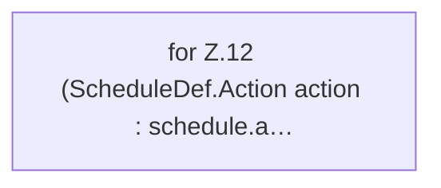

[[00 Start]] › [[Zeitplaene]] › [[Plan-Klassen]] › [[ScheduleExecution]] › [[ScheduleExecution.run]]

# ScheduleExecution.run

`ScheduleExecution.run(ScheduleDef schedule, ActionHandler handler)` [src/main/java/de/aichele/childlauncher/ScheduleExecution.java:11–13](https://github.com/Sciddie/minecraft-serverhoster-plugin/blob/95b02b953b0b4c23673e900e021a7c3c844aa37d/src/main/java/de/aichele/childlauncher/ScheduleExecution.java#L11-L13)



```knoten
for Z.12 (ScheduleDef.Action action : schedule.a…
  Zeile 12: Schleife `(ScheduleDef.Action action : schedule.a…`.
```

- `run` in `src/main/java/de/aichele/childlauncher/ScheduleExecution.java`
