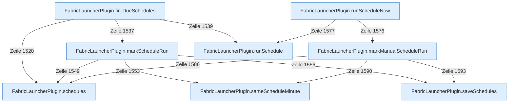

[[00 Start]] › [[Zeitplaene]] › [[Schedules]]

# Schedules



```knoten
FabricLauncherPlugin.schedules
  Das [[Glossar#Plugin|Plugin]] macht hier einen einzelnen Schritt. Eine Ebene tiefer steht er genauer.
FabricLauncherPlugin.saveSchedules
  Das [[Glossar#Plugin|Plugin]] speichert die Zeitpläne.
FabricLauncherPlugin.fireDueSchedules
  Das [[Glossar#Plugin|Plugin]] stößt an Fälliges die Zeitpläne.
FabricLauncherPlugin.markScheduleRun
  Das [[Glossar#Plugin|Plugin]] merkt sich den [[Glossar#Zeitplan|Zeitplan]] den Lauf.
FabricLauncherPlugin.sameScheduleMinute
  Das [[Glossar#Plugin|Plugin]] plant Zeitpunkt.
FabricLauncherPlugin.runScheduleNow
  Das [[Glossar#Plugin|Plugin]] führt aus den [[Glossar#Zeitplan|Zeitplan]] sofort.
FabricLauncherPlugin.markManualScheduleRun
  Das [[Glossar#Plugin|Plugin]] merkt sich die Handarbeit den [[Glossar#Zeitplan|Zeitplan]] den Lauf.
FabricLauncherPlugin.runSchedule
  Das [[Glossar#Plugin|Plugin]] führt aus den [[Glossar#Zeitplan|Zeitplan]].
```

> [!knoten] Was die Blöcke tun
> - **FabricLauncherPlugin.schedules**: Das [[Glossar#Plugin|Plugin]] macht hier einen einzelnen Schritt. Eine Ebene tiefer steht er genauer.
> - **FabricLauncherPlugin.saveSchedules**: Das [[Glossar#Plugin|Plugin]] speichert die Zeitpläne.
> - **FabricLauncherPlugin.fireDueSchedules**: Das [[Glossar#Plugin|Plugin]] stößt an Fälliges die Zeitpläne.
> - **FabricLauncherPlugin.markScheduleRun**: Das [[Glossar#Plugin|Plugin]] merkt sich den [[Glossar#Zeitplan|Zeitplan]] den Lauf.
> - **FabricLauncherPlugin.sameScheduleMinute**: Das [[Glossar#Plugin|Plugin]] plant Zeitpunkt.
> - **FabricLauncherPlugin.runScheduleNow**: Das [[Glossar#Plugin|Plugin]] führt aus den [[Glossar#Zeitplan|Zeitplan]] sofort.
> - **FabricLauncherPlugin.markManualScheduleRun**: Das [[Glossar#Plugin|Plugin]] merkt sich die Handarbeit den [[Glossar#Zeitplan|Zeitplan]] den Lauf.
> - **FabricLauncherPlugin.runSchedule**: Das [[Glossar#Plugin|Plugin]] führt aus den [[Glossar#Zeitplan|Zeitplan]].

- Die Zeitpläne. Ein [[Glossar#Wecker|Wecker]] sieht alle zwanzig Sekunden nach, ob einer fällig ist.
