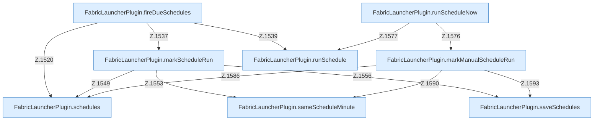

[[00 Start]] › [[Zeitplaene]] › [[Schedules]]

# Schedules



```knoten
FabricLauncherPlugin.schedules
  `schedules` in `FabricLauncherPlugin.java`. Ruft `load`.
FabricLauncherPlugin.saveSchedules
  Speichert `saveSchedules`. Ruft `toConfig`, `saveConfigWritable`.
FabricLauncherPlugin.fireDueSchedules
  Führt Fälliges aus in `fireDueSchedules`. Ruft `schedules`, `matches`, `cron`.
FabricLauncherPlugin.markScheduleRun
  Merkt `markScheduleRun`. Ruft `schedules`, `sameScheduleMinute`, `withLastRun`.
FabricLauncherPlugin.sameScheduleMinute
  Vergleicht `sameScheduleMinute`.
FabricLauncherPlugin.runScheduleNow
  Führt aus `runScheduleNow`. Ruft `markManualScheduleRun`, `runSchedule`.
FabricLauncherPlugin.markManualScheduleRun
  Merkt `markManualScheduleRun`. Ruft `schedules`, `sameScheduleMinute`, `withLastRun`.
FabricLauncherPlugin.runSchedule
  Führt aus `runSchedule`. Ruft `noteTask`, `run`, `TaskDef`.
```


