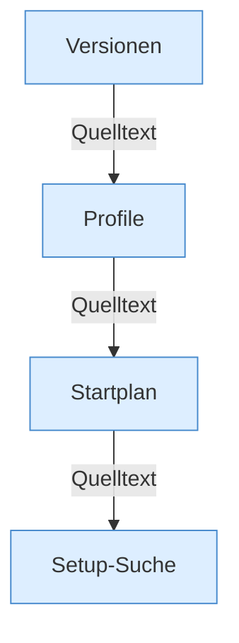

[[00 Start]] › [[Server-Anlage]]

# Server-Anlage



```knoten
Versionen
  Versionsbefehle des Plugins und der Katalog aus dem Netz.
Profile
  Ein Serverprofil aus der Config.
Startplan
  Properties, Pfadprüfung, Startargumente, Jar und Spigot-Bau.
Setup-Suche
  Sucht eine vorhandene Anlage und stellt sie wieder her.
```

- `Profiles.load` liest `servers.*`, der Plugin-Kern behält einen Server.
